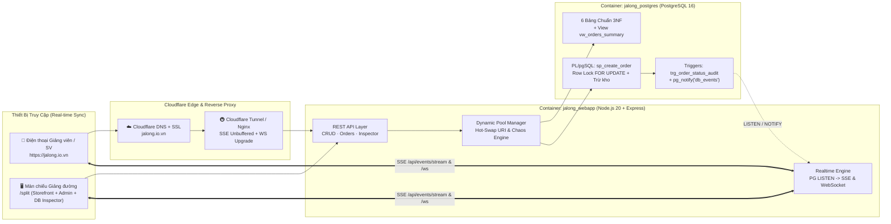
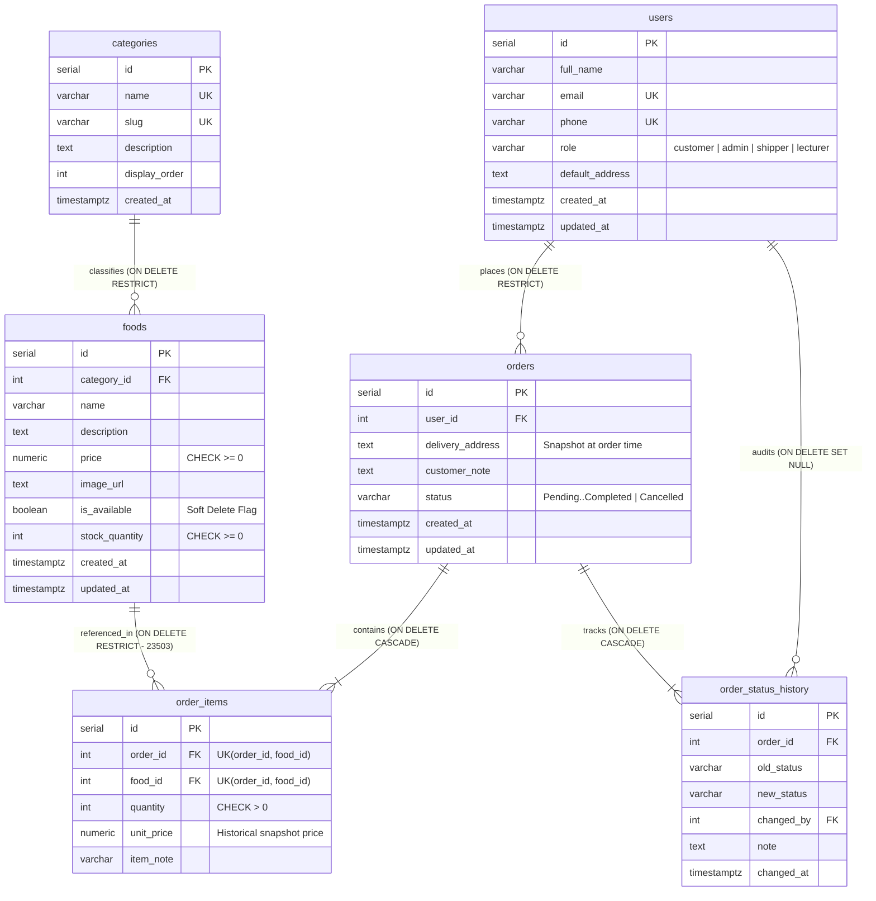

# 🍜 JaLong CyberFood — Hệ Thống Đặt Đồ Ăn Trực Tuyến & Trình Soi CSDL Thời Gian Thực (PostgreSQL 16 · Chuẩn 3NF)

> **Đồ án Thiết Kế Cơ Sở Dữ Liệu — Live Interactive Database Demonstration Platform**  
> Thiết kế chuẩn **3NF nghiêm ngặt (6 bảng + View tổng hợp)** · Giao dịch nguyên tử **PL/pgSQL Stored Procedure (`sp_create_order`)** · Kiểm toán tự động qua **Database Trigger (`trg_order_status_audit`)** · Đồng bộ thời gian thực từ nhân CSDL bằng **PostgreSQL `LISTEN/NOTIFY` + SSE/WebSocket** · Giao diện khách hàng **Cyberpunk Neon đỉnh cao chớp chớp** tách riêng trải nghiệm ẩm thực thuần túy · Bảng điều khiển **DB Live Inspector** riêng cho Giảng viên kiểm thử chịu lỗi trực tiếp · Vận hành thực tế trên tên miền chính thức **[https://jalong.io.vn](https://jalong.io.vn)**.

---

## 📑 Mục Lục

1. [Tổng Quan Kiến Trúc & Hệ Thống Đa Tác Tử (5 Sub-Agents)](#1-tổng-quan-kiến-trúc--hệ-thống-đa-tác-tử-5-sub-agents)
2. [Thiết Kế CSDL Chuẩn 3NF Nghiêm Ngặt (ERD & Giải Trình Học Thuật)](#2-thiết-kế-csdl-chuẩn-3nf-nghiêm-ngặt-erd--giải-trình-học-thuật)
3. [Cấu Trúc Thư Mục Dự Án](#3-cấu-trúc-thư-mục-dự-án)
4. [Hướng Dẫn Chạy Nhanh (Docker Compose 1 Chạm hoặc Node.js + PostgreSQL)](#4-hướng-dẫn-chạy-nhanh-docker-compose-1-chạm-hoặc-nodejs--postgresql)
5. [Hướng Dẫn Triển Khai Tên Miền `jalong.io.vn` Với Cloudflare DNS & Tunnel](#5-hướng-dẫn-triển-khai-tên-miền-jalongiovn-với-cloudflare-dns--tunnel)
6. [🎯 Kịch Bản 5 Phút Demo Trực Quan Nhất Cho Giảng Viên (Minute-by-Minute Script)](#6--kịch-bản-5-phút-demo-trực-quan-nhất-cho-giảng-viên-minute-by-minute-script)
7. [Xử Lý Sự Cố Thường Gặp (Troubleshooting)](#7-xử-lý-sự-cố-thường-gặp-troubleshooting)

---

## 1. Tổng Quan Kiến Trúc & Hệ Thống Đa Tác Tử (5 Sub-Agents)

Hệ thống được thiết kế không chỉ như một website đặt món thông thường, mà là một **"Phòng thí nghiệm CSDL trực quan" (Glass-Box Database Lab)**: mọi thao tác của người dùng trên giao diện đều cho phép Giảng viên quan sát tức thì câu lệnh SQL thực thi, biến động dữ liệu trên 6 bảng, cơ chế khóa dòng chống bán lố tồn kho, mã lỗi khóa ngoại từ PostgreSQL và luồng sự kiện `PG NOTIFY` đẩy thẳng lên trình duyệt trong vài mili-giây.



### Phân Công Kiến Trúc Đa Tác Tử (5-Sub-Agent Engineering Swarm)

| Phân hệ | Vai trò chuyên trách | Thành phần cốt lõi đảm nhiệm |
| :--- | :--- | :--- |
| **Sub-Agent 1**<br/>*Database Architect* | Kiến trúc sư CSDL quan hệ & lập trình PL/pgSQL | Thiết kế 6 bảng chuẩn **3NF** (`01_schema_ddl.sql`), View `vw_orders_summary`, Stored Procedure đặt hàng nguyên tử `sp_create_order`, hệ thống Trigger ghi vết `trg_order_status_audit` & phát sóng `pg_notify` (`02_triggers_and_procs.sql`), cùng bộ dữ liệu mẫu tiếng Việt (`03_seed_data.sql`). |
| **Sub-Agent 2**<br/>*Realtime & Pool Engineer* | Kỹ sư Kết nối Động, Chaos Testing & Luồng Thời gian thực | Xây dựng `poolManager.js` hỗ trợ đổi nóng `DATABASE_URL` không cần khởi động lại server, giả lập sập DB (`SIMULATED_DB_OFFLINE`) / độ trễ mạng, ghi nhật ký truy vấn SQL trực tiếp và cầu nối `pgNotifyListener.js` -> `sseManager.js` (`/api/events/stream`) & `wsManager.js` (`/ws`). |
| **Sub-Agent 3**<br/>*Backend API Engineer* | Kỹ sư RESTful API & Toàn vẹn Nghiệp vụ | Xây dựng các route `/api/foods`, `/api/categories`, `/api/orders`, `/api/db/*`, `/api/inspector/*`; bóc tách chi tiết mã lỗi SQLSTATE của PostgreSQL (đặc biệt mã `23503` `foreign_key_violation`, `23505` `unique_violation`, `23514` `check_violation`, `P0001` hết tồn kho) để hiển thị trực quan phục vụ giảng dạy. |
| **Sub-Agent 4**<br/>*Frontend & Visualization* | Kỹ sư Giao diện Trực quan & Split-Screen Lab | Phát triển 4 phân khu giao diện đồng bộ tức thì: **Storefront** (`/`), **Admin Kitchen & Chaos Control** (`/admin`), **DB Live Inspector 3NF** (`/inspector`), và **Chế độ Chia màn hình thuyết trình** (`/split`). |
| **Sub-Agent 5**<br/>*DevOps & Cloud Infra* | Kỹ sư Hạ tầng Docker, Nginx & Cloudflare | Đóng gói Multi-stage `backend/Dockerfile`, điều phối `docker-compose.yml` có Healthcheck chuẩn, cấu hình Nginx Reverse Proxy & Cloudflare Tunnel tối ưu cho SSE/WebSocket trên `jalong.io.vn`, cùng bộ script 1 chạm `start-demo.ps1` và `setup-cloudflare-tunnel.ps1`. |

---

## 2. Thiết Kế CSDL Chuẩn 3NF Nghiêm Ngặt (ERD & Giải Trình Học Thuật)



### Điểm Nhấn Giải Trình Chuẩn 3NF Trước Hội Đồng / Giảng Viên

1. **Triệt tiêu phụ thuộc hàm bắc cầu (3NF) qua bảng `categories`:**
   - Tách riêng `categories(id, name, slug, description)` khỏi `foods`, loại bỏ hoàn toàn phụ thuộc bắc cầu `food_id -> category_id -> category_name`.
2. **Loại bỏ thuộc tính dẫn xuất dư thừa `total_amount` khỏi bảng `orders`:**
   - Trong thiết kế 3NF nghiêm ngặt, bảng `orders` **không lưu cột cứng `total_amount`** nhằm tránh *Dị thường cập nhật (Update Anomaly)* khi chi tiết món thay đổi. Tổng tiền và tổng số món được tính động chính xác tuyệt đối qua View `vw_orders_summary` (`SUM(quantity * unit_price)`).
3. **Bảo toàn dữ liệu lịch sử giao dịch (`unit_price` & `delivery_address`):**
   - `foods.price` là giá niêm yết hiện hành trên thực đơn, còn `order_items.unit_price` phụ thuộc hàm vào cặp khóa `(order_id, food_id)` — lưu giá chốt tại thời điểm mua. Khi Admin tăng/giảm giá món ăn hôm nay, hóa đơn cũ của khách hàng trong quá khứ không bao giờ bị sai lệch!
   - Tương tự, `orders.delivery_address` lưu địa chỉ nhận hàng cụ thể của đơn đó, độc lập với `users.default_address`.
4. **Chiến lược Toàn vẹn Tham chiếu 3 cấp độ rõ ràng (`RESTRICT` · `CASCADE` · `SET NULL`):**
   - `order_items.food_id -> foods.id (ON DELETE RESTRICT)`: Chặn xóa cứng món ăn đã từng phát sinh hóa đơn (PostgreSQL lập tức trả về mã lỗi **`23503`**), hướng dẫn quản trị viên dùng cơ chế **Ẩn món / Ngừng bán (`is_available = FALSE` - Soft Delete)**.
   - `order_items.order_id -> orders.id (ON DELETE CASCADE)`: Chi tiết đơn là thực thể yếu phụ thuộc vào đơn hàng gốc.
   - `order_status_history.changed_by -> users.id (ON DELETE SET NULL)`: Giữ nguyên biên bản kiểm toán thời gian thực ngay cả khi tài khoản nhân viên thao tác bị thu hồi.

---

## 3. Cấu Trúc Thư Mục Dự Án

```text
c:\Project\ThietKeDatabase\
├── database/
│   ├── 01_schema_ddl.sql              # DDL 6 bảng chuẩn 3NF, Constraints, B-Tree Indexes & View vw_orders_summary
│   ├── 02_triggers_and_procs.sql      # Stored Procedure sp_create_order, Trigger lịch sử trạng thái & PG NOTIFY
│   └── 03_seed_data.sql               # Dữ liệu mẫu thực tế (Người dùng, Danh mục, Thực đơn Việt, Đơn hàng mẫu)
├── backend/
│   ├── Dockerfile                     # Multi-stage Node 20 Alpine image (tích hợp HEALTHCHECK /api/db/status)
│   ├── package.json                   # Express, pg, ws, cors, dotenv
│   ├── .env.example                   # Mẫu biến môi trường kết nối PostgreSQL
│   └── src/
│       ├── server.js                  # Entrypoint HTTP + WebSocket Server + Static UI Router
│       ├── db/
│       │   └── poolManager.js         # Quản lý pg.Pool động, Query Logger & Chaos Testing (Offline/Bad URI)
│       ├── realtime/
│       │   ├── eventBus.js            # Trục điều phối sự kiện nội bộ
│       │   ├── pgNotifyListener.js    # Kết nối chuyên biệt lắng nghe LISTEN/NOTIFY từ PostgreSQL
│       │   ├── sseManager.js          # Quản lý luồng Server-Sent Events (/api/events/stream)
│       │   └── wsManager.js           # Quản lý kết nối WebSocket (/ws)
│       └── routes/                    # Các nhóm API: foods, categories, orders, db status/chaos, inspector
├── frontend/
│   ├── index.html                     # Giao diện Khách hàng đặt món (Storefront)
│   ├── admin.html                     # Giao diện Quản trị bếp, CRUD Món ăn & Bảng điều khiển Chaos DB
│   ├── inspector.html                 # DB Live Inspector: Sơ đồ ERD 3NF, Soi 6 bảng & Live SQL Stream
│   ├── demo-split.html                # Giao diện Split-Screen (/split) ghép đa màn hình cho buổi bảo vệ
│   ├── css/                           # Hệ thống giao diện hiện đại, hỗ trợ hiển thị rõ nét trên máy chiếu
│   └── js/                            # Logic kết nối API, tự động đồng bộ SSE/WebSocket & hiệu ứng highlight dòng mới
├── deploy/
│   ├── start-demo.ps1                 # Script PowerShell bật Docker Compose, chờ Healthcheck & mở /split
│   ├── setup-cloudflare-tunnel.ps1    # Script PowerShell đăng nhập, tạo Tunnel, trỏ DNS & phát jalong.io.vn
│   ├── cloudflare/
│   │   └── config.yml.example         # Cấu hình mẫu Cloudflare Tunnel tối ưu SSE & WebSocket
│   └── nginx/
│       └── jalong.io.vn.conf       # Cấu hình Nginx Reverse Proxy chuẩn Cloudflare Full (Strict) SSL
├── start-demo.cmd                     # Launcher 1 chạm cho Windows (tự động vượt ExecutionPolicy)
├── setup-cloudflare.cmd               # Launcher Cloudflare Tunnel cho Windows (tự động vượt ExecutionPolicy)
├── docker-compose.yml                 # Điều phối PostgreSQL 16 + WebApp + Cloudflare Tunnel (profile optional)
├── .gitignore                         # Loại trừ node_modules, .env, pgdata, log và khóa bí mật Cloudflare
└── README.md                          # Tài liệu kiến trúc, triển khai & Kịch bản thuyết trình 5 phút
```

---

## 4. Hướng Dẫn Chạy Nhanh (Docker Compose 1 Chạm hoặc Node.js + PostgreSQL)

### Cách 1: Khởi Chạy 1 Chạm Bằng `start-demo.cmd` + Docker Desktop *(Khuyên dùng khi Báo cáo)*

> **Lưu ý trên Windows:** Mặc định Windows PowerShell bật `ExecutionPolicy Restricted` chặn chạy trực tiếp file `.ps1`. Dự án đã tích hợp sẵn bộ launcher **`.cmd`** tự động gọi `powershell -NoProfile -ExecutionPolicy Bypass` — chạy mượt trên mọi máy Windows (CMD, PowerShell hoặc nhấp đúp chuột) mà **không bao giờ bị lỗi phân quyền script**!

Chỉ cần máy tính đã cài **Docker Desktop**, mở Terminal (PowerShell hoặc CMD) tại thư mục gốc dự án và chạy duy nhất 1 lệnh:

```powershell
.\start-demo.cmd
```

*(Hoặc nếu muốn gọi trực tiếp file `.ps1`: `powershell -NoProfile -ExecutionPolicy Bypass -File .\deploy\start-demo.ps1`)*

> **Mẹo trước giờ lên bục giảng:** Để xóa sạch mọi dữ liệu thử nghiệm trước đó và nạp lại 100% Schema 3NF + Seed Data mới tinh, hãy thêm cờ `-ResetDb`:
> ```powershell
> .\start-demo.cmd -ResetDb
> ```

Script sẽ tự động:
1. Kiểm tra Docker Desktop (tự động dò tìm cả `C:\Program Files\Docker\...` lẫn `%LOCALAPPDATA%\Programs\DockerDesktop\...` và bật Docker Desktop nếu đang tắt).
2. Build và khởi chạy `jalong_postgres` (PostgreSQL 16) + `jalong_webapp` (Node.js 20).
3. Tự động nạp lần lượt `01_schema_ddl.sql` -> `02_triggers_and_procs.sql` -> `03_seed_data.sql`.
4. Chờ cả 2 container đạt trạng thái `HEALTHY` (`/api/db/status` trả về `200 OK`) rồi tự động mở trình duyệt ở chế độ chia màn hình **`http://localhost:3000/split`**.

---

### Cách 2: Sử Dụng Lệnh Docker Compose Chuẩn

```powershell
# Khởi dựng và chạy ngầm toàn bộ hệ thống
docker compose up -d --build

# Kiểm tra trạng thái Healthcheck
docker compose ps

# Xem log trực tiếp
docker compose logs -f app

# Dừng và xóa Volume để làm mới dữ liệu gốc từ đầu
docker compose down -v
```

---

### Cách 3: Chạy Thủ Công Bằng Node.js 20+ & PostgreSQL 16 Trên Máy Local (Không Dùng Docker)

1. **Khởi tạo Database và nạp 3 script SQL theo đúng thứ tự:**
   ```powershell
   # Tạo user và database trên PostgreSQL local (chạy với tài khoản postgres)
   psql -U postgres -c "CREATE USER jalong_admin WITH PASSWORD 'jalong_secret_2026';"
   psql -U postgres -c "CREATE DATABASE jalong_food_db OWNER jalong_admin ENCODING 'UTF8';"

   # Nạp Schema 3NF -> Triggers & Stored Procs -> Dữ liệu mẫu
   psql -U jalong_admin -d jalong_food_db -f database/01_schema_ddl.sql
   psql -U jalong_admin -d jalong_food_db -f database/02_triggers_and_procs.sql
   psql -U jalong_admin -d jalong_food_db -f database/03_seed_data.sql
   ```

2. **Cấu hình và chạy Backend + Frontend:**
   ```powershell
   cd backend
   Copy-Item .env.example .env
   npm install
   npm run dev
   ```
3. Mở trình duyệt tại: `http://localhost:3000/split`

---

### Bảng Tổng Hợp Đường Dẫn Giao Diện & Thông Tin Kết Nối DB

| Phân khu chức năng | Đường dẫn Local | Đường dẫn Public (Cloudflare) |
| :--- | :--- | :--- |
| **Split-Screen Demo (Khuyên dùng khi thuyết trình)** | `http://localhost:3000/split` | `https://jalong.io.vn/split` |
| **Storefront — Khách hàng đặt món** | `http://localhost:3000/` | `https://jalong.io.vn` |
| **Admin — Quản lý Bếp, Món ăn & Chaos Testing** | `http://localhost:3000/admin` | `https://jalong.io.vn/admin` |
| **DB Live Inspector — ERD 3NF & Soi 6 Bảng Sống** | `http://localhost:3000/inspector` | `https://inspector.jalong.io.vn` |
| **API Kiểm tra Sức khỏe Kết nối CSDL** | `http://localhost:3000/api/db/status` | `https://jalong.io.vn/api/db/status` |

**Thông tin kết nối trực tiếp bằng DBeaver / pgAdmin 4 / DataGrip:**
- **Host:** `localhost` | **Port:** `5432`
- **Database:** `jalong_food_db`
- **Username:** `jalong_admin` | **Password:** `jalong_secret_2026`

---

## 5. Hướng Dẫn Triển Khai Tên Miền `jalong.io.vn` Với Cloudflare DNS & Tunnel

Để Giảng viên và cả lớp có thể quét mã QR / nhập trực tiếp **`https://jalong.io.vn`** trên điện thoại cá nhân (4G/5G/Wi-Fi trường) mà **không cần mở Port trên Router Wi-Fi giảng đường**, dự án hỗ trợ sẵn **Cloudflare Tunnel (`cloudflared`)** và **Nginx Reverse Proxy**.

### Phương Án A: Phát Trực Tiếp Từ Laptop Thuyết Trình Qua `setup-cloudflare.cmd` *(Khuyên dùng)*

**Điều kiện chuẩn bị một lần duy nhất:** Tên miền `jalong.io.vn` đã được thêm vào tài khoản Cloudflare (trạng thái *Active*).

1. Đảm bảo ứng dụng đang chạy ở cổng `3000` (`.\start-demo.cmd`).
2. Mở một cửa sổ Terminal (PowerShell hoặc CMD) thứ hai và chạy:
   ```powershell
   .\setup-cloudflare.cmd
   ```
   *(Hoặc kiểm tra nhanh môi trường không chặn luồng: `.\setup-cloudflare.cmd -CheckOnly` · gọi trực tiếp `.ps1`: `powershell -NoProfile -ExecutionPolicy Bypass -File .\deploy\setup-cloudflare-tunnel.ps1`)*
3. Script sẽ tự động thực hiện tuần tự 6 bước thân thiện:
   - **Bước 1:** Tự động dò tìm `cloudflared` ở mọi thư mục cài đặt (`Program Files`, `Program Files (x86)`, `WinGet`) hoặc hỗ trợ cài tự động qua `winget install --id Cloudflare.cloudflared`.
   - **Bước 2:** Kiểm tra chứng chỉ `~/.cloudflared/cert.pem`. Nếu chưa có, hiển thị menu lựa chọn thân thiện: **`[1]` Đăng nhập Cloudflare Dashboard** (chọn zone **`jalong.io.vn`** -> bấm **Authorize**) hoặc **`[2]` Dùng ngay Quick Tunnel miễn phí**.
   - **Bước 3:** Tự động khởi tạo Tunnel tên **`jalongfood-demo`** và lấy UUID.
   - **Bước 4:** Tự động tạo 3 bản ghi **CNAME (Proxied - Đám mây cam)** trên bảng điều khiển Cloudflare DNS:
     - `jalong.io.vn` -> `<TUNNEL_UUID>.cfargotunnel.com`
     - `www.jalong.io.vn` -> `<TUNNEL_UUID>.cfargotunnel.com`
     - `inspector.jalong.io.vn` -> `<TUNNEL_UUID>.cfargotunnel.com`
   - **Bước 5:** Sinh file `deploy/cloudflare/config.yml` (dựa trên mẫu `deploy/cloudflare/config.yml.example`, mã hóa UTF-8 không BOM) với `disableChunkedEncoding: false` và `httpHostHeader` chuẩn xác để giữ kết nối **SSE (`/api/events/stream`)** và **WebSocket (`/ws`)** mượt mà không bị ngắt quãng.
   - **Bước 6:** Khởi chạy đường hầm kết nối thẳng từ Edge của Cloudflare về `http://localhost:3000`!

> **Dự phòng khẩn cấp không cần tài khoản / không cần `cert.pem`:** Nếu muốn tạo ngay lập tức một link HTTPS công khai tạm thời (`https://*.trycloudflare.com`) trong 3 giây, chỉ cần chạy:
> ```powershell
> .\setup-cloudflare.cmd -QuickTunnel
> ```

---

### Phương Án B: Chạy Cloudflare Tunnel Hoàn Toàn Trong Docker (`--profile cloudflare`)

Nếu bạn sử dụng **Remotely-managed Tunnel Token** từ trang [Cloudflare Zero Trust Dashboard](https://one.dash.cloudflare.com/) (*Networks -> Tunnels*):

1. Tạo Tunnel trên Zero Trust Dashboard, sao chép chuỗi **Tunnel Token**.
2. Trong mục **Public Hostname** của Tunnel trên Dashboard, thêm:
   - `jalong.io.vn` -> Service: **`http://jalong_webapp:3000`**
   - `www.jalong.io.vn` -> Service: **`http://jalong_webapp:3000`**
   - `inspector.jalong.io.vn` -> Service: **`http://jalong_webapp:3000`**
3. Tạo file `.env` tại thư mục gốc dự án:
   ```env
   CLOUDFLARE_TUNNEL_TOKEN=eyJhIjoi...token_cua_ban...
   ```
4. Khởi chạy Docker Compose kèm profile `cloudflare`:
   ```powershell
   docker compose --profile cloudflare up -d --build
   ```

---

### Phương Án C: Triển Khai Trên Máy Chủ VPS Linux Với Nginx + Cloudflare Full (Strict) SSL

Khi triển khai cố định trên VPS có địa chỉ IP Public:
1. Trên **Cloudflare DNS**, trỏ bản ghi `A` cho `@` (`jalong.io.vn`), `www`, và `inspector` về IP của VPS (bật **Proxied — Đám mây cam**).
2. Vào **SSL/TLS -> Overview**, chọn chế độ mã hóa **Full (strict)**.
3. Vào **SSL/TLS -> Origin Server -> Create Certificate**, lưu chứng chỉ và khóa riêng vào `/etc/ssl/cloudflare/jalong.io.vn.pem` và `/etc/ssl/cloudflare/jalong.io.vn.key`.
4. Sao chép file cấu hình mẫu `deploy/nginx/jalong.io.vn.conf` vào `/etc/nginx/sites-available/jalong.io.vn.conf` (đã tối ưu riêng `proxy_buffering off; proxy_cache off; proxy_read_timeout 86400s;` cho `/api/events/stream` và `Upgrade` cho `/ws`):
   ```bash
   sudo ln -s /etc/nginx/sites-available/jalong.io.vn.conf /etc/nginx/sites-enabled/
   sudo nginx -t && sudo systemctl reload nginx
   ```

---

## 6. 🎯 Kịch Bản 5 Phút Demo Trực Quan Nhất Cho Giảng Viên (Minute-by-Minute Script)

> **Chuẩn bị 2 phút trước khi lên trình bày:**
> 1. Chạy `.\start-demo.cmd -ResetDb` để làm sạch CSDL và mở sẵn màn hình **`http://localhost:3000/split`** trên máy chiếu.
> 2. Chạy `.\setup-cloudflare.cmd` (hoặc `.\setup-cloudflare.cmd -QuickTunnel` nếu dùng link tạm) ở cửa sổ terminal nền để kích hoạt kết nối HTTPS công khai cho điện thoại.

---

### ⏱️ Phút 1 (00:00 – 01:00): Giới Thiệu ERD Chuẩn 3NF & Trình Soi 6 Bảng Sống Động (`DB Live Inspector`)

- **Thao tác trên màn hình:**
  1. Trên giao diện `/split` (hoặc mở tab `DB Live Inspector` `/inspector`), hiển thị sơ đồ **ERD 6 bảng chuẩn 3NF** và bấm chuyển nhanh qua 6 thẻ bảng: `users`, `categories`, `foods`, `orders`, `order_items`, `order_status_history`.
  2. Chỉ vào bảng `orders` (không có cột `total_amount`) đối chiếu với View tổng hợp `vw_orders_summary`.
- **Hiện tượng quan sát tức thì:**
  - Số lượng bản ghi thực tế của từng bảng, khóa chính (`PK`), khóa ngoại (`FK`), chỉ mục và nhật ký truy vấn SQL (`Recent SQL Queries`) hiện rõ theo thời gian thực.
- **Lời thuyết trình gợi ý:**
  > *"Thưa Thầy/Cô, toàn bộ CSDL PostgreSQL 16 của nhóm gồm 6 bảng tuân thủ nghiêm ngặt chuẩn 3NF: bảng `categories` được tách độc lập để khử phụ thuộc bắc cầu; bảng `orders` tuyệt đối không lưu dư thừa cột `total_amount` nhằm chống dị thường cập nhật mà tính động qua View `vw_orders_summary`; đồng thời `order_items` chốt cứng `unit_price` lịch sử tại thời điểm giao dịch."*

---

### ⏱️ Phút 2 (01:00 – 02:00): Demo CRUD Món Ăn & Chứng Minh Ràng Buộc Khóa Ngoại 3NF (`ON DELETE RESTRICT` Mã `23503`)

- **Thao tác trên màn hình:**
  1. Tại khung **Admin (`/admin`)**, **thêm mới** một món ăn (ví dụ: *"Bún Bò Huế Đặc Biệt - 65.000đ"*) -> quan sát món xuất hiện ngay lập tức bên khung **Storefront** và bảng `foods` trên **Inspector**, sau đó bấm **Xóa** món vừa tạo (thành công vì chưa có đơn hàng nào tham chiếu).
  2. Tiếp theo, bấm **Xóa cứng (Hard Delete)** một món ăn chủ lực đã từng có khách đặt trong `order_items` (ví dụ: *Phở Bò Tái Lăn*).
  3. Sau khi hệ thống hiện cảnh báo lỗi Khóa ngoại, bấm chuyển sang **Ẩn món / Ngừng bán (Soft Delete - `is_available = FALSE`)**.
- **Hiện tượng quan sát tức thì:**
  - Khi xóa cứng món đã có trong hóa đơn, PostgreSQL lập tức chặn đứng thao tác và trả về mã lỗi chuẩn **SQLSTATE `23503` (`foreign_key_violation` trên `fk_order_items_food`)** hiển thị rõ ràng trên màn hình!
  - Khi chuyển sang Soft Delete, món biến mất khỏi menu đặt hàng của khách nhưng toàn bộ hóa đơn lịch sử trong `order_items` vẫn nguyên vẹn 100%.
- **Lời thuyết trình gợi ý:**
  > *"Đây là minh chứng sống cho ràng buộc toàn vẹn tham chiếu `ON DELETE RESTRICT`: PostgreSQL bảo vệ dữ liệu kế toán ngay từ tầng nhân CSDL với mã lỗi `23503`, không cho phép xóa món đã phát sinh giao dịch ngay cả khi code ứng dụng có sơ suất. Giải pháp chuẩn thực tế là cập nhật cờ `is_available = FALSE`."*

---

### ⏱️ Phút 3 (02:00 – 03:00): Đặt Đơn Hàng Nguyên Tử (`sp_create_order`) & Đồng Bộ Real-Time SSE / PG-Notify + Trigger Ghi Vết

- **Thao tác trên màn hình:**
  1. Ở khung **Storefront**, chọn 2–3 món bỏ vào giỏ hàng (chú ý cột tồn kho `stock_quantity` hiện tại của món trên `Inspector`) và nhấn **Đặt hàng ngay**.
  2. Ngay lập tức ở khung **Admin**, bấm chuyển trạng thái đơn vừa tạo lần lượt: **`Pending` -> `Preparing` -> `Delivering` -> `Completed`**.
  3. Nhìn sang khung **DB Live Inspector**, mở bảng `order_status_history` và bảng `foods`.
- **Hiện tượng quan sát tức thì:**
  - Stored Procedure `sp_create_order` thực thi trong một Transaction duy nhất: khóa dòng `SELECT ... FOR UPDATE`, trừ chính xác `stock_quantity` trong bảng `foods`, tạo dòng trong `orders` + `order_items`.
  - **Không cần F5 tải lại trang**, đơn hàng nổ tức thì bên màn hình Admin và cập nhật trạng thái trực tiếp bên màn hình Khách hàng qua luồng **PostgreSQL `NOTIFY` -> SSE `/api/events/stream`**.
  - Bảng `order_status_history` tự động sinh đủ 4 bản ghi kiểm toán (`NULL -> Pending`, `Pending -> Preparing`, `Preparing -> Delivering`, `Delivering -> Completed`) kèm dấu thời gian chính xác nhờ Trigger `trg_order_status_audit`!
- **Lời thuyết trình gợi ý:**
  > *"Toàn bộ nghiệp vụ đặt hàng chạy qua Stored Procedure `sp_create_order` có khóa dòng `FOR UPDATE` chống bán âm tồn kho khi nhiều người mua cùng lúc. Mỗi khi trạng thái đơn thay đổi, Trigger trong PostgreSQL vừa tự động ghi nhật ký kiểm toán vào `order_status_history`, vừa bắn tín hiệu `pg_notify` đẩy thẳng qua SSE lên mọi màn hình dưới 50ms."*

---

### ⏱️ Phút 4 (03:00 – 04:00): Chaos Testing Trực Tiếp Cho Giảng Viên — Mô Phỏng Sập DB & Khôi Phục 1 Chạm

- **Thao tác trên màn hình:**
  1. Mở khu vực **Database Chaos & Connection Control** trên trang Admin / Inspector.
  2. Bấm nút **Mô phỏng Sập kết nối CSDL (Simulate DB Offline)** hoặc **Đổi Connection String sai mật khẩu/sai cổng** (ví dụ đổi port `5432` -> `5999`).
  3. Thử bấm đặt hàng hoặc tải dữ liệu để chứng minh hệ thống bắt lỗi an toàn không sập tiến trình Node.js.
  4. Bấm nút **Khôi phục Kết nối Mặc định 1 Chạm (Restore Healthy Connection)**.
- **Hiện tượng quan sát tức thì:**
  - Toàn bộ thanh trạng thái trên cả 3 khung màn hình lập tức chuyển sang **Báo động Đỏ (`DB DISCONNECTED / HTTP 503`)** đồng thời phát cảnh báo thời gian thực tới mọi trình duyệt.
  - Ngay khi bấm **Khôi phục 1 Chạm**, `poolManager` khởi tạo lại Pool kết nối chuẩn tới PostgreSQL, đăng ký lại kênh `LISTEN`, và toàn hệ thống chuyển về **Trạng thái Xanh (`CONNECTED`)** mượt mà không mất bất kỳ dữ liệu nào!
- **Lời thuyết trình gợi ý:**
  > *"Để chứng minh hệ thống kết nối thực 100% tới PostgreSQL chứ không dùng dữ liệu giả trên RAM, nhóm tích hợp bộ Chaos Testing trực tiếp: khi ngắt kết nối hoặc nhập sai Connection String, toàn hệ thống báo động đỏ tức thì với mã 503 mà không làm crash Web Server, và chỉ cần 1 chạm để tự động tái lập Pool kết nối xanh trở lại."*

---

### ⏱️ Phút 5 (04:00 – 05:00): Kiểm Chứng Vận Hành Thực Tế Qua `https://jalong.io.vn` Trên Điện Thoại Của Giảng Viên

- **Thao tác trên màn hình:**
  1. Mời Giảng viên và các bạn sinh viên dưới lớp mở camera / trình duyệt trên điện thoại cá nhân (dùng 4G/5G độc lập hoàn toàn với mạng máy tính), truy cập **`https://jalong.io.vn`**.
  2. Mời Giảng viên tự tay chọn món và bấm **Đặt hàng** ngay trên điện thoại của Thầy/Cô.
  3. Trên máy chiếu giảng đường (`/split`), xác nhận đơn của Giảng viên vừa nhảy vào hệ thống và bấm duyệt trạng thái sang `Preparing` -> `Delivering` -> `Completed`.
- **Hiện tượng quan sát tức thì:**
  - Đơn hàng từ điện thoại 4G của Giảng viên đi qua Cloudflare DNS & Cloudflare Tunnel (`jalong.io.vn`), ghi thẳng vào PostgreSQL 16 và hiện lên máy chiếu của lớp trong tích tắc!
  - Đồng thời màn hình điện thoại trên tay Giảng viên tự động nhảy thanh tiến trình giao hàng theo thời gian thực khi nhóm bấm duyệt trên máy chiếu!
- **Lời thuyết trình gợi ý:**
  > *"Cuối cùng, hệ thống đã được triển khai thực tế lên Internet qua hạ tầng Cloudflare DNS & Cloudflare Tunnel với chứng chỉ HTTPS bảo mật tại tên miền `https://jalong.io.vn`, cấu hình chống đệm luồng SSE chuyên biệt. Đơn hàng Thầy/Cô vừa đặt trên điện thoại đã được ghi nhận vào PostgreSQL và đồng bộ hai chiều theo thời gian thực lên màn hình lớn. Nhóm xin chân thành cảm ơn Thầy/Cô và sẵn sàng trả lời câu hỏi phản biện ạ!"*

---

## 7. Xử Lý Sự Cố Thường Gặp (Troubleshooting)

- **Lỗi PowerShell chặn chạy file `.ps1` (`running scripts is disabled on this system` / `PSSecurityException`):**
  - Luôn ưu tiên chạy thông qua hai file wrapper **`.\start-demo.cmd`** và **`.\setup-cloudflare.cmd`** ở thư mục gốc (đã tích hợp sẵn cờ `-NoProfile -ExecutionPolicy Bypass`), hoặc gọi tường minh:
    ```powershell
    powershell -NoProfile -ExecutionPolicy Bypass -File .\deploy\start-demo.ps1
    powershell -NoProfile -ExecutionPolicy Bypass -File .\deploy\setup-cloudflare-tunnel.ps1
    ```
- **Cổng `5432` hoặc `3000` đang bị chiếm bởi dịch vụ khác trên Windows:**
  - Kiểm tra tiến trình chiếm cổng: `netstat -ano | findstr :3000` hoặc `netstat -ano | findstr :5432`.
  - Nếu máy bạn đã cài sẵn dịch vụ PostgreSQL của Windows chạy ngầm ở cổng `5432`, hãy dừng tạm thời dịch vụ đó trong `services.msc` (hoặc chạy `Stop-Service postgresql*` trong PowerShell quyền Admin) trước khi chạy Docker Compose.
- **Muốn nạp lại dữ liệu gốc sau khi đã test xóa/sửa nhiều lần:**
  - Chạy `.\start-demo.cmd -ResetDb` (hoặc `docker compose down -v && docker compose up -d`).
- **SSE không cập nhật tức thì khi qua Reverse Proxy tự cấu hình:**
  - Đảm bảo Nginx đã tắt bộ đệm (`proxy_buffering off; gzip off;`) như mẫu trong `deploy/nginx/jalong.io.vn.conf`, và Cloudflare không bật tính năng *Rocket Loader* làm can thiệp script thời gian thực.
