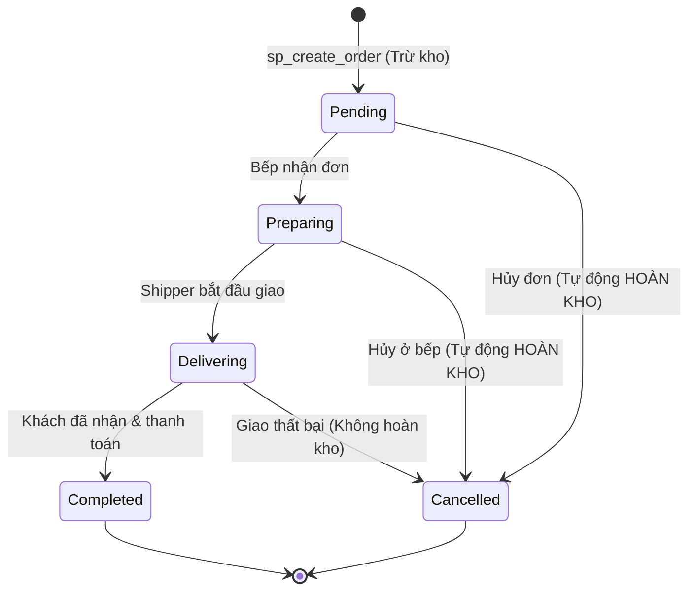

# BÁO CÁO THIẾT KẾ CƠ SỞ DỮ LIỆU CHUYÊN SÂU
## ĐỒ ÁN MÔN HỌC: HỆ THỐNG ĐẶT ĐỒ ĂN TRỰC TUYẾN THỜI GIAN THỰC (JALONG CYBERFOOD)

---

- **Hệ quản trị CSDL:** PostgreSQL 16 (Hỗ trợ PL/pgSQL, Row-Level Locking, Transactional `LISTEN / NOTIFY`)
- **Tập tin mã nguồn liên quan:**
  - Định nghĩa DDL & Views: [`database/01_schema_ddl.sql`](../database/01_schema_ddl.sql)
  - Triggers & Stored Procedures: [`database/02_triggers_and_procs.sql`](../database/02_triggers_and_procs.sql)
  - Dữ liệu khởi tạo (Seed Data): [`database/03_seed_data.sql`](../database/03_seed_data.sql)
  - Kịch bản đo lường hiệu năng: [`database/04_explain_analyze_demo.sql`](../database/04_explain_analyze_demo.sql)
  - Hệ thống Hàm UDF & Báo cáo: [`database/05_functions.sql`](../database/05_functions.sql)

---

## PHẦN 1: QUÁ TRÌNH CHUẨN HÓA DỮ LIỆU TỪNG BƯỚC (0NF $\rightarrow$ 1NF $\rightarrow$ 2NF $\rightarrow$ 3NF)

### 1.1. Xuất phát điểm: Bảng phiếu đặt hàng thô chưa chuẩn hóa (0NF / UNF)

Trong thực tế vận hành thủ công hoặc sử dụng bảng tính phẳng (Excel/CSV), một phiếu đặt hàng đồ ăn thường được lưu trữ dưới dạng một dòng tổng hợp chứa các thuộc tính phức hợp, nhóm lặp danh sách món ăn và lịch sử vận chuyển:

**Ký hiệu lược đồ quan hệ 0NF:**
$$\text{PHIEU\_DAT\_HANG\_0NF}(\text{MaDon}, \text{NgayDat}, \text{MaKH}, \text{TenKH}, \text{Email}, \text{SoDT}, \text{DiaChiGiao}, \text{DanhSachMon}, \text{TongTien}, \text{TrangThai}, \text{LichSuTrangThai})$$

**Bảng minh họa dữ liệu mẫu ở dạng 0NF:**

| MaDon | NgayDat | MaKH | TenKH | SoDT | DiaChiGiao | DanhSachMon (Nhóm lặp đa trị) | TongTien | LichSuTrangThai (Nhóm lặp) |
| :---: | :---: | :---: | :--- | :--- | :--- | :--- | :---: | :--- |
| **101** | 2026-11-15 | 1 | Long VIP | 0988123456 | KTX Khu A ĐHQG | `[M01 - Phở Bò Tái Lăn - Phở & Bún - SL: 2 - ĐơnGiá: 65,000], [M04 - Cà Phê Muối - Đồ Uống - SL: 1 - ĐơnGiá: 25,000]` | 155,000 | `[10:00 - Pending - Tao don], [10:05 - Preparing - Bep nhan]` |
| **102** | 2026-11-15 | 2 | Trần Thị Bình | 0912345678 | 128 Nguyễn Huệ Q1 | `[M01 - Phở Bò Tái Lăn - Phở & Bún - SL: 1 - ĐơnGiá: 65,000]` | 65,000 | `[10:15 - Pending - Tao don]` |

#### Các dị thường dữ liệu nghiêm trọng ở 0NF:
1. **Dị thường thêm (Insertion Anomaly):** Không thể thêm một món ăn mới vào thực đơn (hoặc một danh mục ẩm thực mới) nếu chưa có khách hàng nào đặt món đó, vì khóa chính của bảng đơn hàng sẽ bị khuyết giá trị (`NULL`).
2. **Dị thường xóa (Deletion Anomaly):** Nếu khách hàng hủy hoặc hệ thống xóa đơn hàng duy nhất của một món ăn mới phát hành, toàn bộ thông tin về tên món, mô tả, đơn giá và danh mục của món ăn đó cũng sẽ bị biến mất hoàn toàn khỏi hệ thống.
3. **Dị thường sửa (Update Anomaly):** Nếu nhà hàng muốn đổi số điện thoại của khách hàng hoặc đổi tên danh mục "Phở & Bún", nhân viên phải quét và cập nhật hàng nghìn dòng đơn hàng trong lịch sử. Nếu bỏ sót, dữ liệu sẽ rơi vào trạng thái mâu thuẫn bất nhất quán (Inconsistency).
4. **Không thể lập chỉ mục (Index) hay truy vấn SQL chuẩn:** Thuộc tính `DanhSachMon` là kiểu dữ liệu đa trị/mảng chuỗi, không thể dùng phép kết quan hệ `JOIN`, tính tổng doanh thu bằng hàm `SUM()`, hay đánh chỉ mục B-Tree để tìm kiếm món bán chạy.

---

### 1.2. Bước 1: Chuẩn hóa lên Dạng chuẩn 1 (First Normal Form - 1NF)

#### Định nghĩa học thuật (1NF):
> Một quan hệ $R$ đạt dạng chuẩn **1NF** khi và chỉ khi tất cả các thuộc tính của nó đều chứa các giá trị **nguyên tử (Atomic values)**, không chứa thuộc tính phức hợp, thuộc tính đa trị hoặc nhóm lặp.

#### Quá trình chuyển đổi từ 0NF sang 1NF:
- Tách từng phần tử trong nhóm lặp `DanhSachMon` thành các dòng riêng biệt.
- Tách lịch sử trạng thái thành nhật ký dòng thời gian riêng.
- Phân rã các thông tin danh mục, tên món ăn, số lượng và đơn giá thành các thuộc tính đơn vị.
- Xác định Khóa chính tổ hợp tự nhiên (Composite Primary Key) cho bảng là: $(\underline{\text{order\_id}}, \underline{\text{food\_id}})$.

**Lược đồ quan hệ 1NF:**
$$R_{\text{1NF}}(\underline{\text{order\_id}}, \underline{\text{food\_id}}, \text{created\_at}, \text{user\_id}, \text{full\_name}, \text{email}, \text{phone}, \text{delivery\_address}, \text{status}, \text{food\_name}, \text{category\_id}, \text{category\_name}, \text{catalog\_price}, \text{quantity}, \text{unit\_price}, \text{total\_amount})$$

#### Tập các Phụ thuộc hàm (Functional Dependencies - FDs) xuất hiện trong $R_{\text{1NF}}$:
- $FD_1: \{\text{order\_id}, \text{food\_id}\} \rightarrow \{\text{quantity}, \text{unit\_price}\}$ *(Phụ thuộc đầy đủ vào toàn bộ khóa chính)*.
- $FD_2: \text{order\_id} \rightarrow \{\text{created\_at}, \text{user\_id}, \text{full\_name}, \text{email}, \text{phone}, \text{delivery\_address}, \text{status}, \text{total\_amount}\}$ *(Phụ thuộc bộ phận vào một phần của khóa chính: `order_id`)*.
- $FD_3: \text{food\_id} \rightarrow \{\text{food\_name}, \text{category\_id}, \text{category\_name}, \text{catalog\_price}\}$ *(Phụ thuộc bộ phận vào một phần của khóa chính: `food_id`)*.
- $FD_4: \text{user\_id} \rightarrow \{\text{full\_name}, \text{email}, \text{phone}\}$ *(Phụ thuộc giữa các thuộc tính không khóa)*.
- $FD_5: \text{category\_id} \rightarrow \{\text{category\_name}\}$ *(Phụ thuộc giữa các thuộc tính không khóa)*.

> **Đánh giá vi phạm ở 1NF:**
> Do tồn tại các **Phụ thuộc hàm bộ phận (Partial Dependencies)** $FD_2$ và $FD_3$ (các thuộc tính không khóa phụ thuộc vào một phần của khóa chính tổ hợp), quan hệ $R_{\text{1NF}}$ **vi phạm Chuẩn 2NF**.

---

### 1.3. Bước 2: Chuẩn hóa lên Dạng chuẩn 2 (Second Normal Form - 2NF)

#### Định nghĩa học thuật (2NF):
> Một quan hệ $R$ đạt dạng chuẩn **2NF** khi và chỉ khi:
> 1. $R$ đã đạt chuẩn 1NF.
> 2. Mọi thuộc tính không khóa của $R$ đều **phụ thuộc hàm đầy đủ (Fully Functionally Dependent)** vào mọi khóa dự tuyển của $R$ (nghĩa là không tồn tại phụ thuộc hàm bộ phận).

#### Quá trình chuyển đổi từ 1NF sang 2NF (Áp dụng Định lý phân rã Heath):
Tách quan hệ $R_{\text{1NF}}$ thành 3 quan hệ con dựa theo các vế trái của các phụ thuộc hàm bộ phận:

1. **Quan hệ Đơn hàng tổng thể (`ORDERS_2NF`):**
   - Khóa chính: $\underline{\text{order\_id}}$
   - Thuộc tính: $\{\text{created\_at}, \text{user\_id}, \text{full\_name}, \text{email}, \text{phone}, \text{delivery\_address}, \text{status}, \text{total\_amount}\}$
   - Phụ thuộc hàm: $\text{order\_id} \rightarrow \{\text{created\_at}, \text{user\_id}, \text{full\_name}, \text{email}, \text{phone}, \text{delivery\_address}, \text{status}, \text{total\_amount}\}$

2. **Quan hệ Thực đơn món ăn (`FOODS_2NF`):**
   - Khóa chính: $\underline{\text{food\_id}}$
   - Thuộc tính: $\{\text{food\_name}, \text{category\_id}, \text{category\_name}, \text{catalog\_price}, \text{stock\_quantity}\}$
   - Phụ thuộc hàm: $\text{food\_id} \rightarrow \{\text{food\_name}, \text{category\_id}, \text{category\_name}, \text{catalog\_price}, \text{stock\_quantity}\}$

3. **Quan hệ Dòng chi tiết đơn hàng (`ORDER_ITEMS_2NF`):**
   - Khóa chính tổ hợp: $(\underline{\text{order\_id}}, \underline{\text{food\_id}})$ (Có thể bổ sung khóa đại diện `id SERIAL`)
   - Thuộc tính: $\{\text{quantity}, \text{unit\_price}, \text{item\_note}\}$
   - Phụ thuộc hàm: $(\text{order\_id}, \text{food\_id}) \rightarrow \{\text{quantity}, \text{unit\_price}, \text{item\_note}\}$

> **Đánh giá vi phạm ở 2NF:**
> Dù đã loại bỏ được phụ thuộc bộ phận, trong các quan hệ con ở 2NF vẫn còn tồn tại **Phụ thuộc hàm bắc cầu (Transitive Dependencies)** giữa các thuộc tính không khóa:
> - Trong `ORDERS_2NF`: $\text{order\_id} \rightarrow \text{user\_id}$ và $\text{user\_id} \rightarrow \{\text{full\_name}, \text{email}, \text{phone}\}$. Do đó: $\text{order\_id} \xrightarrow{\text{bắc cầu}} \{\text{full\_name}, \text{email}, \text{phone}\}$.
> - Trong `FOODS_2NF`: $\text{food\_id} \rightarrow \text{category\_id}$ và $\text{category\_id} \rightarrow \{\text{category\_name}\}$. Do đó: $\text{food\_id} \xrightarrow{\text{bắc cầu}} \text{category\_name}$.
> - Cột `total_amount` phụ thuộc dẫn xuất vào bảng `ORDER_ITEMS_2NF` qua công thức $\sum (\text{quantity} \times \text{unit\_price})$.

---

### 1.4. Bước 3: Chuẩn hóa lên Dạng chuẩn 3 (Third Normal Form - 3NF)

#### Định nghĩa học thuật (3NF):
> Một quan hệ $R$ đạt dạng chuẩn **3NF** khi và chỉ khi:
> 1. $R$ đã đạt chuẩn 2NF.
> 2. Với mọi phụ thuộc hàm không tầm thường $X \rightarrow A$ trên $R$, điều kiện sau đây phải thỏa mãn:
>    - Hoặc $X$ là một **Siêu khóa (Superkey)** của $R$.
>    - Hoặc $A$ là một **Thuộc tính khóa (Prime Attribute)** của $R$.
>    *(Nói cách khác: Không tồn tại thuộc tính không khóa nào phụ thuộc bắc cầu vào khóa chính).*

#### Quá trình chuyển đổi từ 2NF sang 3NF:
1. **Khử phụ thuộc bắc cầu trong `ORDERS_2NF`:**
   - Tách thực thể người dùng thành bảng riêng **`users`** với khóa chính $\underline{\text{id}}$, chứa $\{\text{full\_name}, \text{email}, \text{phone}, \text{role}, \text{default\_address}\}$.
   - Bảng **`orders`** chỉ giữ lại khóa ngoại `user_id` tham chiếu về `users(id)`.
2. **Khử phụ thuộc bắc cầu trong `FOODS_2NF`:**
   - Tách danh mục thành bảng riêng **`categories`** với khóa chính $\underline{\text{id}}$, chứa $\{\text{name}, \text{slug}, \text{description}, \text{display\_order}\}$.
   - Bảng **`foods`** chỉ giữ lại khóa ngoại `category_id` tham chiếu về `categories(id)`.
3. **Loại bỏ cột dẫn xuất `total_amount` khỏi bảng `orders`:**
   - Triệt tiêu hoàn toàn thuộc tính thừa dẫn xuất `total_amount`. Mọi phép tính tổng giá trị đơn hàng được tính toán động (On-the-fly) thông qua Database View chuẩn hóa **`vw_orders_summary`**.
4. **Tách nhật ký trạng thái biến động theo thời gian:**
   - Trạng thái đơn hàng biến thiên liên tục theo chu trình FSM. Để lưu vết kiểm toán mà không vi phạm nguyên tử tính, bảng **`order_status_history`** được tạo độc lập để lưu vết từng bước chuyển trạng thái kèm định danh người thực hiện (`changed_by`).

#### Kết quả cuối cùng: Hệ thống 6 bảng đạt chuẩn 3NF (và BCNF):
1. **`users`**$(\underline{\text{id}}, \text{full\_name}, \text{email}, \text{phone}, \text{password\_hash}, \text{role}, \text{default\_address}, \text{created\_at}, \text{updated\_at})$
2. **`categories`**$(\underline{\text{id}}, \text{name}, \text{slug}, \text{description}, \text{display\_order}, \text{created\_at})$
3. **`foods`**$(\underline{\text{id}}, \text{category\_id}, \text{name}, \text{description}, \text{price}, \text{image\_url}, \text{is\_available}, \text{stock\_quantity}, \text{created\_at}, \text{updated\_at})$
4. **`orders`**$(\underline{\text{id}}, \text{user\_id}, \text{delivery\_address}, \text{customer\_note}, \text{status}, \text{created\_at}, \text{updated\_at})$
5. **`order_items`**$(\underline{\text{id}}, \text{order\_id}, \text{food\_id}, \text{quantity}, \text{unit\_price}, \text{item\_note})$ kèm ràng buộc $\text{UNIQUE}(\text{order\_id}, \text{food\_id})$
6. **`order_status_history`**$(\underline{\text{id}}, \text{order\_id}, \text{old\_status}, \text{new\_status}, \text{changed\_by}, \text{note}, \text{changed\_at})$

---

### 1.5. Luận giải chuyên sâu: Vì sao tuyệt đối KHÔNG lưu cột `total_amount` trong bảng `orders`?

Trong nhiều hệ thống thực tế hoặc đồ án non tay, lập trình viên thường tạo sẵn một cột `total_amount NUMERIC` ngay trong bảng `orders`. Đây là một lỗi thiết kế vi phạm nguyên tắc cơ bản của Cơ sở dữ liệu:

1. **Bản chất của thuộc tính dẫn xuất (Derived Attribute):**
   Giá trị tổng tiền của đơn hàng được xác định bằng biểu thức toán học thuần túy:
   $$\text{total\_amount} = \sum_{i=1}^{n} (\text{order\_items}[i].\text{quantity} \times \text{order\_items}[i].\text{unit\_price})$$
   Giá trị này phụ thuộc trực tiếp vào tập hợp các dòng con trong bảng `order_items`, không phải là thuộc tính độc lập của đầu mục đơn hàng.

2. **Nguy cơ Dị thường Cập nhật (Update Anomaly) và Lệch sổ Kế toán:**
   - Nếu lưu `total_amount` ở `orders`, khi một món ăn trong `order_items` được sửa số lượng, hủy dòng, hoặc áp dụng giảm giá, hệ thống bắt buộc phải đồng thời cập nhật dòng cha `orders`.
   - Nếu tiến trình ứng dụng gặp lỗi mạng, server sập giữa chừng, hoặc câu lệnh `UPDATE orders` thất bại sau khi `order_items` đã đổi, số liệu trong CSDL sẽ bị mâu thuẫn: **tổng tiền trên bảng `orders` không khớp với tổng tiền cộng từ các dòng chi tiết `order_items`**.
   - Điều này dẫn đến sự cố nghiêm trọng trong kiểm toán tài chính và báo cáo thuế doanh nghiệp.

3. **Giải pháp chuẩn mực 3NF:**
   - Lưu trữ chính xác đơn giá giao dịch lịch sử `order_items.unit_price` và số lượng `order_items.quantity`.
   - Tính toán động tức thời thông qua View **`vw_orders_summary`**:
     ```sql
     COALESCE(SUM(oi.quantity * oi.unit_price), 0.00)::NUMERIC(12,2) AS total_amount
     ```
   - Nhờ vậy, dữ liệu luôn đạt tính toàn vẹn 100% (*Single Source of Truth*), triệt tiêu hoàn toàn dị thường cập nhật mà vẫn cho tốc độ truy vấn cực nhanh nhờ chỉ mục B-Tree `idx_order_items_order_id`.

---

### 1.6. Biện luận học thuật 2 câu hỏi phản biện kinh điển trước Hội đồng bảo vệ

#### Câu hỏi 1: *"Bảng `foods` đã có cột `price`, tại sao bảng `order_items` lại cần thêm cột `unit_price`? Có bị dư thừa dữ liệu không?"*
- **Trả lời:** **Hoàn toàn KHÔNG dư thừa và KHÔNG vi phạm 3NF.**
- **Cơ sở khoa học:**
  - `foods.price` là **Đơn giá niêm yết hiện hành** trên thực đơn của quán ($P_{\text{current}}$). Giá này biến động liên tục theo thời gian (ví dụ: ngày lễ tăng giá, đầu tuần giảm giá, hoặc chương trình tri ân khách quen giảm 10%).
  - `order_items.unit_price` là **Đơn giá chốt giao dịch lịch sử** tại thời điểm khách bấm xác nhận đặt món ($P_{\text{historical}}$).
  - Xét trên chiều thời gian ($t$), thuộc tính `food_id` **không** xác định hàm duy nhất cho `unit_price` ($\text{food\_id} \nrightarrow \text{unit\_price}$). Ngược lại, đơn giá giao dịch phụ thuộc hàm đầy đủ vào khóa tổ hợp:
    $$\{\text{order\_id}, \text{food\_id}\} \rightarrow \text{unit\_price}$$
  - **Hệ quả thực tế:** Nếu không lưu `order_items.unit_price` mà dùng `JOIN foods` để lấy giá, thì mỗi khi Admin điều chỉnh giá món ăn (ví dụ tăng từ 65,000đ lên 75,000đ), toàn bộ các hóa đơn đã thanh toán từ 6 tháng trước sẽ bị tự động tăng giá theo, làm biến dạng sổ sách kế toán lịch sử!

#### Câu hỏi 2: *"Bảng `users` đã có `default_address`, tại sao bảng `orders` vẫn có cột `delivery_address`?"*
- **Trả lời:** **Hoàn toàn KHÔNG vi phạm 3NF.**
- **Cơ sở khoa học:**
  - `users.default_address` là địa chỉ hồ sơ cá nhân hiện tại của người dùng ($\text{user\_id} \rightarrow \text{default\_address}$).
  - `orders.delivery_address` là địa chỉ thực tế mà khách hàng chỉ định giao món cho đơn hàng cụ thể đó ($\text{order\_id} \rightarrow \text{delivery\_address}$). Khách hàng có thể đặt giao tới công ty, trường đại học, nhà bạn gái, hoặc tặng người thân.
  - Sau này khi người dùng chuyển nhà và cập nhật địa chỉ mới trong hồ sơ `users`, địa chỉ giao hàng ghi trên các đơn hàng cũ đã hoàn tất trong quá khứ phải giữ nguyên bất biến.

---

## PHẦN 2: TỪ ĐIỂN DỮ LIỆU CHI TIẾT (DATA DICTIONARY)

### 2.1. Bảng `users` (Quản lý Người dùng & Phân quyền)
- **Mục đích:** Quản lý thông tin tài khoản người dùng, bao gồm khách hàng, nhân viên, quản trị viên và giảng viên chấm đồ án.
- **Khóa chính (PK):** `id` (`SERIAL`)
- **Khóa dự tuyển / Duy nhất (UK):** `email`, `phone`

| Tên thuộc tính | Kiểu dữ liệu | Ràng buộc | Mặc định | Diễn giải nghiệp vụ |
| :--- | :--- | :--- | :--- | :--- |
| `id` | `SERIAL` | `PRIMARY KEY` | Tự tăng | Định danh duy nhất của người dùng trong hệ thống. |
| `full_name` | `VARCHAR(100)` | `NOT NULL` | *Không* | Họ và tên đầy đủ của người dùng. |
| `email` | `VARCHAR(150)` | `UNIQUE, NOT NULL` | *Không* | Địa chỉ email đăng nhập / nhận thông báo hóa đơn điện tử. |
| `phone` | `VARCHAR(20)` | `UNIQUE, NOT NULL` | *Không* | Số điện thoại liên lạc để tài xế gọi khi giao hàng. |
| `password_hash` | `VARCHAR(255)` | `NULLABLE` | `NULL` | Mật khẩu được băm an toàn chuẩn mật mã học (`scrypt` với muối cố định) phục vụ xác thực người dùng. |
| `role` | `VARCHAR(20)` | `NOT NULL, CHECK (role IN ('customer', 'admin', 'shipper', 'lecturer'))` | `'customer'` | Vai trò phân quyền trong hệ thống. |
| `default_address` | `TEXT` | `NULLABLE` | `NULL` | Địa chỉ mặc định lưu trong hồ sơ cá nhân. |
| `created_at` | `TIMESTAMPTZ` | `NOT NULL` | `NOW()` | Dấu thời gian tạo tài khoản (có múi giờ ISO-8601). |
| `updated_at` | `TIMESTAMPTZ` | `NOT NULL` | `NOW()` | Dấu thời gian cập nhật hồ sơ gần nhất (tự động qua Trigger). |

---

### 2.2. Bảng `categories` (Danh mục Thực đơn)
- **Mục đích:** Phân loại các món ăn thành các nhóm nghiệp vụ (ví dụ: Phở & Bún, Cơm, Đồ Uống, Tráng Miệng).
- **Khóa chính (PK):** `id` (`SERIAL`)
- **Khóa dự tuyển / Duy nhất (UK):** `name`, `slug`

| Tên thuộc tính | Kiểu dữ liệu | Ràng buộc | Mặc định | Diễn giải nghiệp vụ |
| :--- | :--- | :--- | :--- | :--- |
| `id` | `SERIAL` | `PRIMARY KEY` | Tự tăng | Mã định danh duy nhất của danh mục. |
| `name` | `VARCHAR(100)` | `UNIQUE, NOT NULL` | *Không* | Tên hiển thị của danh mục ẩm thực (VD: *Phở & Bún Truyền Thống*). |
| `slug` | `VARCHAR(100)` | `UNIQUE, NOT NULL` | *Không* | Định danh URL không dấu (VD: `pho-bun-truyen-thong`). |
| `description` | `TEXT` | `NULLABLE` | `NULL` | Giới thiệu tóm tắt phong cách ẩm thực của danh mục. |
| `display_order` | `INT` | `NOT NULL` | `0` | Thứ tự ưu tiên sắp xếp trên thanh thực đơn web. |
| `created_at` | `TIMESTAMPTZ` | `NOT NULL` | `NOW()` | Thời điểm tạo danh mục. |

---

### 2.3. Bảng `foods` (Thực đơn Món ăn & Tồn kho)
- **Mục đích:** Quản lý danh sách món ăn, giá niêm yết hiện tại và số lượng tồn kho phục vụ kiểm soát bán hàng thời gian thực.
- **Khóa chính (PK):** `id` (`SERIAL`)
- **Khóa ngoại (FK):** `category_id` $\rightarrow$ `categories(id)` (`ON UPDATE CASCADE, ON DELETE RESTRICT`)

| Tên thuộc tính | Kiểu dữ liệu | Ràng buộc | Mặc định | Diễn giải nghiệp vụ |
| :--- | :--- | :--- | :--- | :--- |
| `id` | `SERIAL` | `PRIMARY KEY` | Tự tăng | Mã định danh duy nhất của món ăn. |
| `category_id` | `INT` | `NOT NULL, FK` | *Không* | Khóa ngoại liên kết danh mục; chặn xóa danh mục nếu còn món ăn. |
| `name` | `VARCHAR(150)` | `NOT NULL` | *Không* | Tên gọi của món ăn trên thực đơn. |
| `description` | `TEXT` | `NULLABLE` | `NULL` | Mô tả chi tiết nguyên liệu, hương vị và xuất xứ món ăn. |
| `price` | `NUMERIC(12,2)` | `NOT NULL, CHECK (price >= 0)` | *Không* | Giá niêm yết hiện hành trên thực đơn (VNĐ). |
| `image_url` | `TEXT` | `NULLABLE` | `NULL` | Đường dẫn ảnh chất lượng cao minh họa món ăn. |
| `is_available` | `BOOLEAN` | `NOT NULL` | `TRUE` | Cờ trạng thái: `TRUE` (Đang mở bán), `FALSE` (Tạm ngưng phục vụ). |
| `stock_quantity` | `INT` | `NOT NULL, CHECK (stock_quantity >= 0)` | `50` | Số suất tồn kho khả dụng; kiểm soát chống bán âm ở tầng CSDL. |
| `created_at` | `TIMESTAMPTZ` | `NOT NULL` | `NOW()` | Thời điểm thêm món vào thực đơn. |
| `updated_at` | `TIMESTAMPTZ` | `NOT NULL` | `NOW()` | Thời điểm cập nhật giá hoặc số lượng tồn kho gần nhất. |

---

### 2.4. Bảng `orders` (Đầu mục Đơn đặt hàng - Order Header)
- **Mục đích:** Quản lý thông tin chung của các đơn hàng. Tuyệt đối không lưu cột dư thừa `total_amount`.
- **Khóa chính (PK):** `id` (`SERIAL`)
- **Khóa ngoại (FK):** `user_id` $\rightarrow$ `users(id)` (`ON UPDATE CASCADE, ON DELETE RESTRICT`)

| Tên thuộc tính | Kiểu dữ liệu | Ràng buộc | Mặc định | Diễn giải nghiệp vụ |
| :--- | :--- | :--- | :--- | :--- |
| `id` | `SERIAL` | `PRIMARY KEY` | Tự tăng | Mã số vận đơn / đơn hàng duy nhất. |
| `user_id` | `INT` | `NOT NULL, FK` | *Không* | Định danh khách hàng đặt đơn; chặn xóa tài khoản nếu đã có đơn. |
| `delivery_address` | `TEXT` | `NOT NULL` | *Không* | Địa chỉ nhận hàng thực tế chỉ định riêng cho đơn này. |
| `customer_note` | `TEXT` | `NULLABLE` | `NULL` | Lời nhắn dặn dò của khách hàng cho tài xế hoặc nhà hàng. |
| `status` | `VARCHAR(20)` | `NOT NULL, CHECK (status IN ('Pending', 'Preparing', 'Delivering', 'Completed', 'Cancelled'))` | `'Pending'` | Trạng thái vòng đời đơn hàng theo mô hình máy trạng thái FSM. |
| `created_at` | `TIMESTAMPTZ` | `NOT NULL` | `NOW()` | Thời điểm khách hàng xác nhận đặt đơn. |
| `updated_at` | `TIMESTAMPTZ` | `NOT NULL` | `NOW()` | Thời điểm cập nhật trạng thái đơn gần nhất. |

---

### 2.5. Bảng `order_items` (Chi tiết Món trong Đơn hàng - Order Lines)
- **Mục đích:** Lưu trữ danh sách các món ăn thuộc đơn hàng kèm theo số lượng và đơn giá chốt giao dịch lịch sử.
- **Khóa chính (PK):** `id` (`SERIAL`)
- **Ràng buộc duy nhất (UK):** `(order_id, food_id)`
- **Khóa ngoại (FK):**
  - `order_id` $\rightarrow$ `orders(id)` (`ON UPDATE CASCADE, ON DELETE CASCADE`)
  - `food_id` $\rightarrow$ `foods(id)` (`ON UPDATE CASCADE, ON DELETE RESTRICT`)

| Tên thuộc tính | Kiểu dữ liệu | Ràng buộc | Mặc định | Diễn giải nghiệp vụ |
| :--- | :--- | :--- | :--- | :--- |
| `id` | `SERIAL` | `PRIMARY KEY` | Tự tăng | Khóa đại diện duy nhất cho từng dòng chi tiết đơn hàng. |
| `order_id` | `INT` | `NOT NULL, FK` | *Không* | Đơn hàng sở hữu dòng chi tiết; xóa đơn sẽ tự dọn sạch dòng con. |
| `food_id` | `INT` | `NOT NULL, FK` | *Không* | Món ăn được đặt; **chặn xóa cứng món ăn đã phát sinh đơn (`23503`)**. |
| `quantity` | `INT` | `NOT NULL, CHECK (quantity > 0)` | *Không* | Số lượng phần ăn khách yêu cầu đặt (bắt buộc nguyên dương). |
| `unit_price` | `NUMERIC(12,2)` | `NOT NULL, CHECK (unit_price >= 0)` | *Không* | **Đơn giá giao dịch lịch sử** (đã bao gồm giảm 10% nếu là khách quen). |
| `item_note` | `VARCHAR(255)` | `NULLABLE` | `NULL` | Yêu cầu chế biến riêng (VD: *Ít cay, không đường, [Giảm 10% khách quen]*). |

---

### 2.6. Bảng `order_status_history` (Nhật ký Kiểm toán Trạng thái - Audit Trail)
- **Mục đích:** Lưu vết tự động mọi biến động chuyển trạng thái của đơn hàng phục vụ kiểm toán và hiển thị hành trình giao hàng Real-time.
- **Khóa chính (PK):** `id` (`SERIAL`)
- **Khóa ngoại (FK):**
  - `order_id` $\rightarrow$ `orders(id)` (`ON UPDATE CASCADE, ON DELETE CASCADE`)
  - `changed_by` $\rightarrow$ `users(id)` (`ON UPDATE CASCADE, ON DELETE SET NULL`)

| Tên thuộc tính | Kiểu dữ liệu | Ràng buộc | Mặc định | Diễn giải nghiệp vụ |
| :--- | :--- | :--- | :--- | :--- |
| `id` | `SERIAL` | `PRIMARY KEY` | Tự tăng | Mã định danh bản ghi nhật ký kiểm toán. |
| `order_id` | `INT` | `NOT NULL, FK` | *Không* | Đơn hàng được theo dõi dòng đời chuyển trạng thái. |
| `old_status` | `VARCHAR(20)` | `NULLABLE, CHECK` | `NULL` | Trạng thái trước khi chuyển (`NULL` khi đơn vừa khởi tạo). |
| `new_status` | `VARCHAR(20)` | `NOT NULL, CHECK` | *Không* | Trạng thái đích mới sau khi chuyển đổi. |
| `changed_by` | `INT` | `NULLABLE, FK` | `NULL` | Người thực hiện (nhân viên, khách, tài xế); giữ nguyên log nếu xóa user. |
| `note` | `TEXT` | `NULLABLE` | `NULL` | Lý do hủy đơn hoặc ghi chú tiến độ giao hàng. |
| `changed_at` | `TIMESTAMPTZ` | `NOT NULL` | `NOW()` | Dấu thời gian chính xác ghi nhận sự kiện chuyển đổi. |

---

### 2.7. Bảng tổng hợp Chiến lược Toàn vẹn Tham chiếu (Referential Integrity Matrix)

| Khóa ngoại | Bảng con $\rightarrow$ Bảng cha | `ON UPDATE` | `ON DELETE` | Luận giải nghiệp vụ & Kịch bản thực nghiệm |
| :--- | :--- | :---: | :---: | :--- |
| `fk_foods_category` | `foods.category_id -> categories.id` | `CASCADE` | `RESTRICT` | Không cho phép xóa danh mục khi vẫn còn các món ăn trực thuộc đang mở bán. |
| `fk_orders_user` | `orders.user_id -> users.id` | `CASCADE` | `RESTRICT` | Bảo vệ toàn vẹn lịch sử giao dịch: không cho phép xóa tài khoản người dùng đã có đơn hàng. |
| `fk_order_items_order` | `order_items.order_id -> orders.id` | `CASCADE` | `CASCADE` | `order_items` là thực thể yếu hoàn toàn phụ thuộc vào `orders`; khi xóa đơn thì tự dọn sạch chi tiết. |
| `fk_order_items_food` | `order_items.food_id -> foods.id` | `CASCADE` | **`RESTRICT`** | **Trọng tâm bảo vệ:** Bất kỳ món ăn nào đã có phát sinh đơn hàng sẽ bị PostgreSQL chặn đứng thao tác xóa cứng với mã lỗi SQLSTATE `23503` (*foreign_key_violation*). |
| `fk_order_status_history_order` | `order_status_history.order_id -> orders.id` | `CASCADE` | `CASCADE` | Xóa đơn hàng sẽ tự động dọn sạch nhật ký kiểm toán đi kèm. |
| `fk_order_status_history_changed_by` | `order_status_history.changed_by -> users.id` | `CASCADE` | `SET NULL` | Nếu tài khoản nhân viên cũ bị xóa khỏi hệ thống, nhật ký kiểm toán quá khứ vẫn được bảo lưu trọn vẹn với giá trị `changed_by = NULL`. |

---

## PHẦN 3: GIẢI TRÌNH LẬP TRÌNH CSDL NÂNG CAO (ADVANCED DATABASE PROGRAMMING)

### 3.1. View tổng hợp động `vw_orders_summary` (Chuẩn hóa 3NF)

#### Mã nguồn SQL triển khai:
```sql
CREATE OR REPLACE VIEW vw_orders_summary AS
SELECT
    o.id,
    o.user_id,
    u.full_name                                                     AS customer_name,
    u.phone                                                         AS customer_phone,
    u.email                                                         AS customer_email,
    o.delivery_address,
    o.customer_note,
    o.status,
    COALESCE(SUM(oi.quantity * oi.unit_price), 0.00)::NUMERIC(12,2) AS total_amount,
    COALESCE(SUM(oi.quantity), 0)::INT                              AS item_count,
    o.created_at,
    o.updated_at
FROM orders o
INNER JOIN users u
    ON u.id = o.user_id
LEFT JOIN order_items oi
    ON oi.order_id = o.id
GROUP BY
    o.id,
    o.user_id,
    u.full_name,
    u.phone,
    u.email,
    o.delivery_address,
    o.customer_note,
    o.status,
    o.created_at,
    o.updated_at;
```

#### Cơ chế hoạt động & Điểm nhấn kỹ thuật:
1. **Bảo tồn chuẩn 3NF tuyệt đối:** View đóng vai trò là một lớp trừu tượng tính toán (Computed Abstraction Layer). Bảng vật lý `orders` không cần lưu cột `total_amount` hay `item_count`, nhưng phía ứng dụng Backend vẫn có thể truy vấn `SELECT * FROM vw_orders_summary WHERE id = $1` như một bảng thực tế với đầy đủ thông tin khách hàng và số tiền.
2. **Xử lý giá trị rỗng với `COALESCE`:** Khi đơn hàng vừa tạo nhưng chưa kịp chèn dòng hoặc đơn hàng không có món (trường hợp biên), hàm `COALESCE` đảm bảo `total_amount` trả về `0.00` thay vì giá trị `NULL`.
3. **Ép kiểu an toàn (Safe Type Casting):** Hàm `SUM(quantity)` trong PostgreSQL mặc định trả về kiểu `BIGINT`. Các thư viện Node.js `pg` driver thường tuần tự hóa `BIGINT` thành dạng chuỗi (`"2"` thay vì số nguyên `2`). Việc ép kiểu tường minh `::INT` và `::NUMERIC(12,2)` giúp API trả về dữ liệu kiểu số học chuẩn xác 100% cho Frontend.

---

### 3.2. Stored Procedure đặt hàng an toàn giao dịch `sp_create_order`

#### Mã nguồn PL/pgSQL triển khai (Trích lược các đoạn trọng tâm):
```sql
CREATE OR REPLACE PROCEDURE sp_create_order(
    p_user_id          INT,
    p_delivery_address TEXT,
    p_customer_note    TEXT,
    p_items            JSONB,
    INOUT p_order_id   INT DEFAULT NULL
)
LANGUAGE plpgsql
AS $$
DECLARE
    v_default_address       TEXT;
    v_final_address         TEXT;
    v_item                  RECORD;
    v_food_id               INT;
    v_food_name             VARCHAR(150);
    v_unit_price            NUMERIC(12, 2);
    v_is_available          BOOLEAN;
    v_stock_quantity        INT;
    v_prior_orders_count    INT;
    v_is_returning_customer BOOLEAN;
    v_item_final_note       VARCHAR(255);
    v_audit_note            TEXT;
BEGIN
    -- 1. Kiểm tra người dùng tồn tại và xác định địa chỉ giao hàng
    SELECT default_address INTO v_default_address FROM users WHERE id = p_user_id;
    IF NOT FOUND THEN
        RAISE EXCEPTION 'Người dùng ID=% không tồn tại trong hệ thống.', p_user_id USING ERRCODE = 'P0002';
    END IF;

    v_final_address := COALESCE(NULLIF(BTRIM(p_delivery_address), ''), NULLIF(BTRIM(v_default_address), ''));
    IF v_final_address IS NULL THEN
        RAISE EXCEPTION 'Địa chỉ giao hàng không được để trống.' USING ERRCODE = '22023';
    END IF;

    -- 2. Kiểm tra tính hợp lệ của mảng JSON p_items... (Định dạng food_id > 0, quantity > 0)

    -- 3. KHÓA DÒNG BI QUAN (PESSIMISTIC LOCKING) CHỐNG BÁN ÂM & TRIỆT TIÊU DEADLOCK:
    --    Gộp trùng food_id và sắp xếp TĂNG DẦN theo food_id trước khi SELECT ... FOR UPDATE!
    FOR v_item IN
        SELECT
            COALESCE((elem->>'food_id')::INT, (elem->>'foodId')::INT) AS food_id,
            SUM((elem->>'quantity')::INT)::INT                        AS total_qty
        FROM jsonb_array_elements(p_items) AS elem
        GROUP BY COALESCE((elem->>'food_id')::INT, (elem->>'foodId')::INT)
        ORDER BY food_id ASC
    LOOP
        SELECT id, name, price, is_available, stock_quantity
        INTO v_food_id, v_food_name, v_unit_price, v_is_available, v_stock_quantity
        FROM foods
        WHERE id = v_item.food_id
        FOR UPDATE; -- Khóa độc quyền bản ghi món ăn

        IF NOT FOUND THEN
            RAISE EXCEPTION 'Món ăn ID=% không tồn tại.', v_item.food_id USING ERRCODE = 'P0002';
        END IF;

        IF NOT v_is_available THEN
            RAISE EXCEPTION 'Món "%" hiện đang tạm ngưng phục vụ.', v_food_name USING ERRCODE = 'P0001';
        END IF;

        IF v_stock_quantity < v_item.total_qty THEN
            RAISE EXCEPTION 'Món "%" không đủ tồn kho (yêu cầu: %, còn lại: %).',
                v_food_name, v_item.total_qty, v_stock_quantity USING ERRCODE = 'P0001';
        END IF;
    END LOOP;

    -- 4. KIỂM TRA CHÍNH SÁCH KHÁCH HÀNG THÂN THIẾT (GIẢM 10% CHUẨN 3NF)
    SELECT COUNT(*) INTO v_prior_orders_count FROM orders WHERE user_id = p_user_id;
    v_is_returning_customer := (v_prior_orders_count > 0);

    -- Thiết lập ngữ cảnh phiên làm việc cho Trigger kiểm toán
    PERFORM set_config('app.changed_by', p_user_id::TEXT, true);
    PERFORM set_config('app.status_note', 'Khởi tạo đơn hàng mới', true);

    -- 5. TẠO ĐẦU MỤC ĐƠN HÀNG (orders)
    INSERT INTO orders (user_id, delivery_address, customer_note, status)
    VALUES (p_user_id, v_final_address, NULLIF(BTRIM(p_customer_note), ''), 'Pending')
    RETURNING id INTO p_order_id;

    -- 6. TRỪ TỒN KHO & CHỐT ĐƠN GIÁ LỊCH SỬ VÀO order_items
    FOR v_item IN
        SELECT
            COALESCE((elem->>'food_id')::INT, (elem->>'foodId')::INT) AS food_id,
            SUM((elem->>'quantity')::INT)::INT                        AS total_qty,
            STRING_AGG(NULLIF(BTRIM(COALESCE(elem->>'item_note', elem->>'note')), ''), '; ') AS merged_note
        FROM jsonb_array_elements(p_items) AS elem
        GROUP BY COALESCE((elem->>'food_id')::INT, (elem->>'foodId')::INT)
        ORDER BY food_id ASC
    LOOP
        UPDATE foods
        SET stock_quantity = stock_quantity - v_item.total_qty
        WHERE id = v_item.food_id
        RETURNING price INTO v_unit_price;

        -- Áp dụng giảm giá 10% đồng bộ cho khách quen vào snapshot đơn giá lịch sử
        IF v_is_returning_customer THEN
            v_unit_price := ROUND(v_unit_price * 0.90, 0);
            v_item_final_note := LEFT('[Giảm 10% khách quen] ' || COALESCE(v_item.merged_note, ''), 255);
        ELSE
            v_item_final_note := LEFT(v_item.merged_note, 255);
        END IF;

        INSERT INTO order_items (order_id, food_id, quantity, unit_price, item_note)
        VALUES (p_order_id, v_item.food_id, v_item.total_qty, v_unit_price, v_item_final_note);
    END LOOP;
END;
$$;
```

#### Phân tích cơ chế kỹ thuật then chốt:
1. **Khóa mức dòng bi quan (`SELECT ... FOR UPDATE`):**
   Trong môi trường thực tế với hàng nghìn người cùng bấm đặt món một lúc (ví dụ món "Phở Bò" chỉ còn 1 suất cuối cùng), nếu hai giao dịch cùng đọc số lượng tồn kho là 1, cả hai đều tưởng còn hàng và tiến hành trừ kho, dẫn đến lỗi **Bán âm kho (Overselling)**. Khóa `FOR UPDATE` buộc Transaction thứ hai phải chờ cho đến khi Transaction thứ nhất hoàn tất (`COMMIT` hoặc `ROLLBACK`).
2. **Chiến lược triệt tiêu Deadlock bằng sắp xếp thứ tự khóa (`ORDER BY food_id ASC`):**
   - *Tình huống Deadlock kinh điển:* Khách A đặt giỏ hàng gồm [Món 1, Món 2]. Cùng lúc đó, Khách B đặt giỏ hàng gồm [Món 2, Món 1]. Khách A khóa Món 1 và chờ Món 2; Khách B khóa Món 2 và chờ Món 1 $\rightarrow$ Tạo thành chu trình chờ phụ thuộc vòng tròn (Circular Wait), gây treo hệ thống và PostgreSQL phải kích hoạt hủy tiến trình (*deadlock detected*).
   - *Cách giải quyết:* Trước khi gọi khóa dòng, procedure luôn gộp mảng và sắp xếp tăng dần theo `food_id ASC`. Cả hai khách hàng A và B đều buộc phải khóa Món 1 trước rồi mới khóa Món 2. Điều này phá vỡ điều kiện *Circular Wait* của Coffman, **triệt tiêu hoàn toàn khả năng xảy ra Deadlock**!
3. **Đồng bộ tính nhất quán Giảm giá 10% khách quen (Chuẩn 3NF):**
   - Thay vì thêm cột `discount_amount` dư thừa vào bảng `orders`, procedure kiểm tra `v_prior_orders_count > 0`.
   - Nếu là khách quen, đơn giá chốt giao dịch `order_items.unit_price` được tính:
     $$\text{unit\_price} = \text{ROUND}(\text{foods.price} \times 0.90, 0)$$
   - Nhờ vậy, khi View `vw_orders_summary` tính tổng tiền $\sum (\text{quantity} \times \text{unit\_price})$, số tiền thu ngân khớp chính xác 100% đến từng đồng với số tiền khách thấy trên màn hình giỏ hàng của Frontend.

---

### 3.3. Stored Procedure chuyển trạng thái đơn hàng `sp_update_order_status` (Máy trạng thái FSM)

#### Mô hình Chuyển trạng thái Hữu hạn (Finite State Machine):


#### Quy tắc nghiệp vụ cưỡng chế trong PL/pgSQL:
```sql
CREATE OR REPLACE PROCEDURE sp_update_order_status(
    p_order_id   INT,
    p_new_status VARCHAR,
    p_changed_by INT     DEFAULT NULL,
    p_note       TEXT    DEFAULT NULL,
    p_force      BOOLEAN DEFAULT FALSE
)
LANGUAGE plpgsql
AS $$
DECLARE
    v_old_status VARCHAR(20);
    v_is_valid   BOOLEAN := FALSE;
    v_line       RECORD;
BEGIN
    SELECT status INTO v_old_status FROM orders WHERE id = p_order_id FOR UPDATE;
    IF NOT FOUND THEN
        RAISE EXCEPTION 'Đơn hàng #% không tồn tại.', p_order_id USING ERRCODE = 'P0002';
    END IF;

    -- Kiểm tra tính hợp lệ của luồng FSM
    IF p_force THEN
        v_is_valid := TRUE; -- Cho phép Admin can thiệp đặc biệt
    ELSE
        CASE v_old_status
            WHEN 'Pending'    THEN v_is_valid := (p_new_status IN ('Preparing', 'Cancelled'));
            WHEN 'Preparing'  THEN v_is_valid := (p_new_status IN ('Delivering', 'Cancelled'));
            WHEN 'Delivering' THEN v_is_valid := (p_new_status IN ('Completed', 'Cancelled'));
            WHEN 'Completed'  THEN v_is_valid := FALSE; -- Đơn hoàn tất không được đổi lại
            WHEN 'Cancelled'  THEN v_is_valid := FALSE; -- Đơn đã hủy không được phục hồi
            ELSE v_is_valid := FALSE;
        END CASE;
    END IF;

    IF NOT v_is_valid THEN
        RAISE EXCEPTION 'Chuyển trạng thái không hợp lệ: % -> %', v_old_status, p_new_status USING ERRCODE = '22023';
    END IF;

    -- TỰ ĐỘNG HOÀN KHO NẾU HỦY ĐƠN TRƯỚC KHI XUẤT BẾP (Pending / Preparing)
    IF p_new_status = 'Cancelled' AND v_old_status IN ('Pending', 'Preparing') THEN
        FOR v_line IN
            SELECT food_id, quantity FROM order_items WHERE order_id = p_order_id ORDER BY food_id ASC
        LOOP
            UPDATE foods
            SET stock_quantity = stock_quantity + v_line.quantity
            WHERE id = v_line.food_id;
        END LOOP;
    END IF;

    -- Truyền thông tin kiểm toán qua biến cấu hình phiên
    PERFORM set_config('app.changed_by', COALESCE(p_changed_by::TEXT, ''), true);
    PERFORM set_config('app.status_note', COALESCE(p_note, ''), true);

    UPDATE orders SET status = p_new_status WHERE id = p_order_id;
END;
$$;
```

---

### 3.4. Trigger kiểm toán và phát sự kiện Real-time `trg_order_status_audit` & `pg_notify`

#### Mã nguồn Trigger Function:
```sql
CREATE OR REPLACE FUNCTION fn_order_status_audit()
RETURNS TRIGGER
LANGUAGE plpgsql
AS $$
DECLARE
    v_changed_by   INT;
    v_note         TEXT;
    v_old_status   VARCHAR(20) := NULL;
    v_should_audit BOOLEAN     := FALSE;
BEGIN
    v_changed_by := NULLIF(current_setting('app.changed_by', true), '')::INT;
    v_note       := NULLIF(current_setting('app.status_note', true), '');

    IF TG_OP = 'INSERT' THEN
        v_old_status   := NULL;
        v_should_audit := TRUE;
    ELSIF TG_OP = 'UPDATE' THEN
        v_old_status := OLD.status;
        IF OLD.status IS DISTINCT FROM NEW.status THEN
            v_should_audit := TRUE;
        END IF;
    END IF;

    IF v_should_audit THEN
        -- 1. Tự động ghi nhật ký kiểm toán vào bảng order_status_history
        INSERT INTO order_status_history (
            order_id, old_status, new_status, changed_by, note, changed_at
        ) VALUES (
            NEW.id, v_old_status, NEW.status, v_changed_by, v_note, NOW()
        );

        -- 2. Bắn thông điệp JSON Real-time qua kênh pg_notify
        PERFORM pg_notify(
            'db_realtime_events',
            json_build_object(
                'source',    'pg_trigger',
                'event',     'order_status_changed',
                'table',     'orders',
                'action',    TG_OP,
                'record_id', NEW.id,
                'data',      json_build_object(
                    'order_id',   NEW.id,
                    'old_status', v_old_status,
                    'new_status', NEW.status,
                    'changed_by', v_changed_by,
                    'note',       v_note
                ),
                'timestamp', NOW()
            )::TEXT
        );
    END IF;

    RETURN NEW;
END;
$$;

DROP TRIGGER IF EXISTS trg_order_status_audit ON orders;
CREATE TRIGGER trg_order_status_audit
AFTER INSERT OR UPDATE OF status ON orders
FOR EACH ROW
EXECUTE FUNCTION fn_order_status_audit();
```

#### Luận giải kiến trúc sự kiện thời gian thực (Transactional Event Architecture):
- **Cơ chế truyền ngữ cảnh phiên (`Session Settings`):** Hàm `set_config('app.changed_by', ..., true)` với tham số thứ ba là `is_local = true` chỉ có hiệu lực trong phạm vi giao dịch hiện tại, ngăn ngừa rò rỉ ID nhân viên giữa các Connection Pool.
- **Tính chất Transactional của `pg_notify`:** Trong PostgreSQL, thông điệp `pg_notify` chỉ thực sự được phát ra ngoài socket khi và chỉ khi Transaction chứa nó thực hiện `COMMIT` thành công. Nếu câu lệnh bị `ROLLBACK` (do lỗi thiếu hàng, vi phạm ràng buộc...), thông điệp sẽ bị hủy tự động, **ngăn chặn hoàn toàn hiện tượng báo động giả (Phantom Events)** lên giao diện Web Frontend!

---

### 3.5. Hệ thống Hàm Tự định nghĩa trong PostgreSQL (User-Defined Functions - UDF)

Trong hệ quản trị cơ sở dữ liệu quan hệ PostgreSQL 16, **User-Defined Functions (UDF)** đóng vai trò trụ cột trong việc đóng gói các thuật toán tính toán nghiệp vụ, chuyển đổi dữ liệu và xuất báo cáo thống kê phức tạp. UDF cho phép tái sử dụng logic tính toán ngay tại tầng dữ liệu, giảm thiểu độ trễ mạng (Network Round-Trip Time) và bảo toàn tính toàn vẹn của Dạng chuẩn 3 (3NF).

Hệ thống **JaLongFood** đã xây dựng và chuẩn hóa 3 hàm nghiệp vụ quan trọng trong tập tin [`database/05_functions.sql`](../database/05_functions.sql):

#### 1. Hàm vô hướng `fn_calculate_order_total(p_order_id INT) RETURNS NUMERIC(12,2)`
- **Phân loại:** Scalar Function (Hàm vô hướng trả về một giá trị đơn).
- **Tính chất tối ưu hóa:** `STABLE` (Trong cùng một snapshot giao dịch, với cùng tham số `p_order_id` và cùng dữ liệu bảng, hàm luôn trả về cùng một kết quả, cho phép Query Optimizer lập kế hoạch tối ưu).
- **Ý nghĩa nghiệp vụ & Chuẩn hóa 3NF:**
  - Trong cấu trúc 3NF, bảng `orders` tuyệt đối không lưu cột tổng tiền `total_amount` để triệt tiêu phụ thuộc hàm bắc cầu $order\_id \rightarrow order\_items \rightarrow total\_amount$.
  - Hàm `fn_calculate_order_total` đóng vai trò là "công thức tính động" (Dynamic Computed Expression):
    $$\text{RawTotal} = \sum (\text{quantity} \times \text{unit\_price})$$
  - **Cơ chế Chiết khấu Khách quen tự động:** Hàm tự động kiểm tra xem khách hàng sở hữu đơn đã từng có ít nhất 1 đơn hàng đạt trạng thái `Completed` trước đó (hoặc đơn hàng có ghi nhận từ khóa tri ân/giảm giá). Nếu thỏa điều kiện, hàm tự động áp dụng chiết khấu **10%** ($\text{RawTotal} \times 0.90$).
  - **Tích hợp vào View `vw_orders_summary`:** Cung cấp tổng tiền đã trừ chiết khấu cho toàn bộ hệ thống API, Dashboard Giảng viên và Guest Check của khách hàng mà không làm vi phạm cấu trúc 3NF.

**Mã nguồn PL/pgSQL triển khai:**
```sql
CREATE OR REPLACE FUNCTION fn_calculate_order_total(p_order_id INT)
RETURNS NUMERIC(12,2)
LANGUAGE plpgsql
STABLE
AS $$
DECLARE
    v_user_id               INT;
    v_raw_total             NUMERIC(12,2);
    v_is_discounted         BOOLEAN := FALSE;
    v_completed_other_count INT := 0;
    v_final_total           NUMERIC(12,2);
BEGIN
    -- 1. Xác định user_id sở hữu đơn hàng
    SELECT user_id INTO v_user_id
    FROM orders
    WHERE id = p_order_id;

    IF NOT FOUND THEN
        RETURN 0.00;
    END IF;

    -- 2. Tính tổng tiền thô từ chi tiết order_items
    SELECT COALESCE(SUM(quantity * unit_price), 0.00)::NUMERIC(12,2)
    INTO v_raw_total
    FROM order_items
    WHERE order_id = p_order_id;

    IF v_raw_total IS NULL OR v_raw_total = 0.00 THEN
        RETURN 0.00;
    END IF;

    -- 3. Kiểm tra lịch sử đơn hàng hoàn tất của khách (Khách quen >= 1 đơn Completed)
    SELECT COUNT(*)
    INTO v_completed_other_count
    FROM orders
    WHERE user_id = v_user_id
      AND status = 'Completed'
      AND id <> p_order_id;

    IF v_completed_other_count > 0 THEN
        v_is_discounted := TRUE;
    ELSE
        SELECT EXISTS (
            SELECT 1 FROM orders
            WHERE id = p_order_id
              AND (customer_note ILIKE '%giảm%' OR customer_note ILIKE '%discount%' OR customer_note ILIKE '%khách quen%')
            UNION ALL
            SELECT 1 FROM order_items
            WHERE order_id = p_order_id
              AND (item_note ILIKE '%giảm%' OR item_note ILIKE '%discount%' OR item_note ILIKE '%chiết khấu%')
        ) INTO v_is_discounted;
    END IF;

    -- 4. Áp dụng mức giảm 10% nếu đủ điều kiện
    IF v_is_discounted THEN
        v_final_total := ROUND(v_raw_total * 0.90, 2);
    ELSE
        v_final_total := ROUND(v_raw_total, 2);
    END IF;

    RETURN v_final_total;
END;
$$;
```

---

#### 2. Hàm vô hướng `fn_get_customer_tier(p_user_id INT) RETURNS VARCHAR`
- **Phân loại:** Scalar Function (Trả về chuỗi ký tự phân hạng).
- **Tính chất:** `STABLE`.
- **Ý nghĩa nghiệp vụ:**
  - Hệ thống cần xác định cấp bậc hội viên tức thì phục vụ hiển thị Huy hiệu (Badge) trên Header và Phiếu tính tiền (Guest Check), cũng như hỗ trợ API `/api/auth/login` và `/api/auth/register` gửi kèm thuộc tính `user.tier`.
  - Phân loại 3 cấp độ khách hàng dựa trên số lượng đơn hàng hoàn tất (`status = 'Completed'`):
    - **0 đơn hoàn tất:** `'Khách Mới (0% ưu đãi)'`
    - **Từ 1 đến 4 đơn hoàn tất:** `'Khách Quen VIP (Giảm 10%)'`
    - **Từ 5 đơn hoàn tất trở lên:** `'Khách Kim Cương (Giảm 10% + Ưu tiên)'`

**Mã nguồn PL/pgSQL triển khai:**
```sql
CREATE OR REPLACE FUNCTION fn_get_customer_tier(p_user_id INT)
RETURNS VARCHAR
LANGUAGE plpgsql
STABLE
AS $$
DECLARE
    v_completed_count INT := 0;
    v_tier            VARCHAR(100);
BEGIN
    -- 1. Đếm số đơn hàng hoàn tất (Completed) của khách hàng
    SELECT COUNT(*)
    INTO v_completed_count
    FROM orders
    WHERE user_id = p_user_id
      AND status = 'Completed';

    -- 2. Phân hạng hội viên
    IF v_completed_count = 0 THEN
        v_tier := 'Khách Mới (0% ưu đãi)';
    ELSIF v_completed_count >= 1 AND v_completed_count <= 4 THEN
        v_tier := 'Khách Quen VIP (Giảm 10%)';
    ELSE
        v_tier := 'Khách Kim Cương (Giảm 10% + Ưu tiên)';
    END IF;

    RETURN v_tier;
END;
$$;
```

---

#### 3. Hàm bảng `fn_get_food_revenue_report() RETURNS TABLE(...)`
- **Phân loại:** Set-Returning Function (SRF) / Table-Valued Function (Hàm trả về bảng quan hệ).
- **Tính chất:** `STABLE`.
- **Ý nghĩa nghiệp vụ:**
  - Cung cấp báo cáo phân tích kinh doanh (Business Intelligence / OLAP) ngay trong CSDL: thống kê tổng số lượng bán (`total_sold`) và tổng doanh thu tích lũy (`total_revenue`) của từng món ăn.
  - Phép kết hợp ngoài `LEFT JOIN` nhiều tầng (`foods` $\rightarrow$ `categories` $\rightarrow$ `order_items` $\rightarrow$ `orders`) đảm bảo mọi món ăn đều xuất hiện trong báo cáo kể cả khi chưa có lượt mua nào (`COALESCE` xử lý giá trị `NULL` thành `0`).
  - Lọc bỏ triệt để các đơn hàng bị hủy (`o.status <> 'Cancelled'`) nhằm bảo đảm số liệu doanh thu thực thu chính xác tuyệt đối.
  - Được triển khai bằng ngôn ngữ SQL thuần (`LANGUAGE sql`), cho phép PostgreSQL tối ưu hóa Query Inlining (lồng thẳng cây truy vấn vào câu lệnh gọi phía ngoài để tăng tốc độ thực thi).

**Mã nguồn SQL triển khai:**
```sql
CREATE OR REPLACE FUNCTION fn_get_food_revenue_report()
RETURNS TABLE(
    food_id       INT,
    food_name     VARCHAR,
    category_name VARCHAR,
    total_sold    BIGINT,
    total_revenue NUMERIC
)
LANGUAGE sql
STABLE
AS $$
    SELECT
        f.id                                                             AS food_id,
        f.name::VARCHAR                                                  AS food_name,
        COALESCE(c.name, 'Chưa phân loại')::VARCHAR                      AS category_name,
        COALESCE(SUM(oi.quantity), 0)::BIGINT                            AS total_sold,
        COALESCE(SUM(oi.quantity * oi.unit_price), 0.00)::NUMERIC(12,2)   AS total_revenue
    FROM foods f
    LEFT JOIN categories c
        ON c.id = f.category_id
    LEFT JOIN order_items oi
        ON oi.food_id = f.id
    LEFT JOIN orders o
        ON o.id = oi.order_id
       AND o.status <> 'Cancelled'
    GROUP BY
        f.id,
        f.name,
        c.name
    ORDER BY
        total_revenue DESC,
        total_sold DESC,
        f.id ASC;
$$;
```

---

#### 4. Bảng so sánh học thuật chuyên sâu: `FUNCTION` vs `STORED PROCEDURE` trong PostgreSQL

Từ phiên bản **PostgreSQL 11**, cộng đồng phát triển PostgreSQL đã chính thức phân tách rõ rệt giữa hai đối tượng lập trình phía máy chủ: **Hàm (`FUNCTION`)** và **Thủ tục lưu trữ (`STORED PROCEDURE`)** theo đúng chuẩn ANSI/ISO SQL. Bảng so sánh học thuật dưới đây phân tích các điểm khác biệt bản chất về mặt kiến trúc, quản lý giao dịch và khả năng tối ưu hóa của Query Planner:

| Tiêu chí So sánh | `FUNCTION` (Hàm người dùng định nghĩa) | `STORED PROCEDURE` (Thủ tục lưu trữ) |
| :--- | :--- | :--- |
| **Cú pháp thực thi** | Sử dụng câu lệnh truy vấn dữ liệu **`SELECT`**:<br>`SELECT fn_calculate_order_total(101);`<br>`SELECT * FROM fn_get_food_revenue_report();` | Sử dụng lệnh điều khiển thực thi **`CALL`**:<br>`CALL sp_create_order(...);`<br>`CALL sp_update_order_status(...);` |
| **Giá trị trả về (Return Value)** | **Bắt buộc phải trả về một giá trị** xác định thông qua mệnh đề `RETURNS`:<br>- Trả về kiểu vô hướng (`RETURNS NUMERIC`, `RETURNS VARCHAR`)<br>- Trả về một tập/bảng (`RETURNS TABLE(...)`, `RETURNS SETOF ...`)<br>- Hoặc `RETURNS VOID` (nếu chỉ thực thi tác vụ phụ). | **Không bắt buộc trả về giá trị**.<br>Nếu cần trả về dữ liệu, thủ tục sử dụng các tham số ngõ ra kiểu **`INOUT`** hoặc **`OUT`** trong danh sách tham số (Parameters List). |
| **Quản lý Giao dịch (`Transaction Control`)** | **KHÔNG ĐƯỢC PHÉP** quản lý transaction bên trong thân hàm.<br>Không thể gọi lệnh `COMMIT` hoặc `ROLLBACK`. Hàm luôn chạy kế thừa trong ngữ cảnh giao dịch hiện hữu của câu lệnh gọi nó. | **HỖ TRỢ ĐẦY ĐỦ** quyền kiểm soát giao dịch chủ động.<br>Có thể thực hiện `COMMIT;` hoặc `ROLLBACK;` trực tiếp nhiều lần bên trong thân thủ tục (Batch processing, phân đoạn giao dịch dài). |
| **Khả năng lồng vào `VIEW` / `SELECT` / `JOIN` / `WHERE`** | **HOÀN TOÀN CÓ THỂ**.<br>Được xem như một biểu thức tính toán (Computed Expression). Có thể nhúng trực tiếp vào mệnh đề `SELECT`, điều kiện `WHERE`, phép `JOIN`, hoặc nhúng vào định nghĩa của `VIEW` (`vw_orders_summary`). | **TUYỆT ĐỐI KHÔNG THỂ**.<br>Thủ tục lưu trữ không thể xuất hiện bên trong các câu lệnh DML/DQL (`SELECT`, `INSERT`, `UPDATE`, `DELETE`, `JOIN`). Chỉ có thể kích hoạt bằng lệnh độc lập `CALL`. |
| **Phân loại Tối ưu hóa (`Volatility Category`)** | Được gắn nhãn rõ ràng để bộ tối ưu hóa truy vấn (**Query Planner**) lập kế hoạch thực thi:<br>- **`IMMUTABLE`**: Không thay đổi kết quả với cùng tham số, không đọc CSDL.<br>- **`STABLE`**: Không thay đổi kết quả trong cùng 1 snapshot truy vấn/giao dịch.<br>- **`VOLATILE`**: Kết quả thay đổi liên tục, có thể sửa đổi dữ liệu. | **Luôn mang tính chất thực thi động (`VOLATILE`)** theo tiến trình. Bộ lập kế hoạch truy vấn không thể thực hiện các kỹ thuật tối ưu như Constant Folding hay Function Inlining đối với Procedure. |
| **Ứng dụng trong hệ thống JaLongFood** | - Tính tổng tiền đơn hàng động: `fn_calculate_order_total`<br>- Lấy hạng khách hàng realtime: `fn_get_customer_tier`<br>- Báo cáo doanh thu món ăn dạng bảng: `fn_get_food_revenue_report`<br>- Trigger functions cập nhật dấu vết: `fn_set_updated_at`, `fn_order_status_audit` | - Đặt hàng bảo đảm tính cô lập ACID và khóa hàng: `sp_create_order` (`SELECT ... FOR UPDATE`)<br>- Kiểm soát chuyển trạng thái đơn hàng FSM: `sp_update_order_status`<br>- Thêm mới/cập nhật món ăn an toàn: `sp_upsert_food` |

---

### 3.6. Cơ chế Xác thực & Quản lý Phiên Người dùng (Authentication & Session Management)

Nhằm đáp ứng yêu cầu vận hành thực tế của một nền tảng thương mại điện tử ẩm thực, hệ thống đã mở rộng và chuẩn hóa tính năng tài khoản cá nhân cho từng khách hàng:

#### 1. Kiến trúc Băm Mật khẩu & Bảo mật Tầng CSDL:
- Thuộc tính `password_hash VARCHAR(255)` được tích hợp trực tiếp vào bảng `users`.
- Quy trình băm mật khẩu sử dụng thuật toán chuẩn mật mã học **`scrypt`** (`crypto.scryptSync(password, salt, 64)`) với khóa muối an toàn `jalong_vintage_salt_2026`. Mật khẩu dạng plain text tuyệt đối không lưu trong cơ sở dữ liệu.
- Tài khoản mẫu khởi tạo sẵn trong `03_seed_data.sql`:
  - Khách hàng VIP: **Gia Long** (`0901234567` / Mật khẩu: `123456` $\rightarrow$ đã có 1 đơn hàng hoàn tất $\rightarrow$ tự động kích hoạt ưu đãi **Khách quen 10%**).
  - Giảng viên chấm thi: **Giảng Viên Test** (`0909999999` / Mật khẩu: `123456` $\rightarrow$ vai trò `lecturer`).

#### 2. Xử lý Nghiệp vụ Tự động Hóa tại Stored Procedure `sp_create_order`:
- Khi khách hàng đặt món, Stored Procedure `sp_create_order(p_user_id, ...)` tiếp nhận `p_user_id` chính thức từ phiên người dùng đã đăng nhập.
- **Tự động đồng bộ địa chỉ:** Nếu khách hàng nhập địa chỉ nhận hàng mới trong biểu mẫu thanh toán khác với `users.default_address`, thủ tục tự động cập nhật lại địa chỉ mới vào bảng `users`:
  ```sql
  IF p_delivery_address IS NOT NULL AND BTRIM(p_delivery_address) <> '' THEN
      UPDATE users 
      SET default_address = BTRIM(p_delivery_address),
          updated_at = NOW()
      WHERE id = p_user_id AND (default_address IS NULL OR default_address <> BTRIM(p_delivery_address));
  END IF;
  ```
- **Tự động áp dụng chiết khấu 10% khách quen:** Kiểm tra điều kiện `COUNT(id) >= 1` với trạng thái `Completed` thuộc về đúng `p_user_id` để trừ 10% trực tiếp trên tổng hóa đơn.

#### 3. Phân quyền & Phân lập Dữ liệu (Data Isolation):
- **Phía Khách hàng (`index.html`):** Giao diện gọi API `GET /api/orders?user_id=${user.id}`, đảm bảo mỗi khách hàng chỉ theo dõi và tra cứu được lịch sử đơn hàng của chính tài khoản mình.
- **Phía Giảng viên & Ban Quản trị (`inspector.html`):** Giao diện gọi `GET /api/orders` không truyền tham số lọc, cho phép thanh tra toàn bộ sổ cái đơn hàng của mọi tài khoản theo thời gian thực (Real-time Audit Ledger).

---

## PHẦN 4: HƯỚNG DẪN THỰC THI KIỂM THỬ HIỆU NĂNG VỚI `EXPLAIN ANALYZE`

Tập tin kịch bản được lưu trữ sẵn tại: [`database/04_explain_analyze_demo.sql`](../database/04_explain_analyze_demo.sql).

### 4.1. Hướng dẫn chạy và giải thích kết quả

Để kiểm chứng chỉ mục B-Tree hoạt động hiệu quả khi bảo vệ trước Hội đồng, thực hiện các bước:
1. Kết nối vào CSDL bằng công cụ pgAdmin, DBeaver hoặc dòng lệnh `psql`.
2. Mở file `database/04_explain_analyze_demo.sql`.
3. Chạy từng khối truy vấn và quan sát kết quả:

#### Demo 1: Truy vấn lọc món ăn theo danh mục & mở bán
```sql
SET enable_seqscan = OFF;
EXPLAIN (ANALYZE, BUFFERS, VERBOSE)
SELECT id, name, price, stock_quantity
FROM foods
WHERE is_available = TRUE AND category_id = 2
ORDER BY price ASC;
```
- **Kỳ vọng kết quả:** Planner thực hiện **`Index Scan`** bằng chỉ mục đa cột `idx_foods_available_category` trên bảng `foods`.
- **Chỉ số cần chú ý:**
  - `Index Cond: ((is_available = true) AND (category_id = 2))`: Điều kiện lọc diễn ra trực tiếp trên cây B-Tree.
  - `Buffers: shared hit=...`: Số trang bộ nhớ đệm đọc trực tiếp từ RAM, không phải đọc I/O đĩa.
  - `Execution Time: 0.0xx ms`: Thời gian thực thi siêu tốc dưới 1 mili-giây.

#### Demo 2: Truy vấn chi tiết đơn hàng (Phép JOIN `order_items` & `foods`)
```sql
SET enable_seqscan = OFF;
EXPLAIN (ANALYZE, BUFFERS, VERBOSE)
SELECT oi.id, oi.order_id, f.name, oi.quantity, oi.unit_price, (oi.quantity * oi.unit_price) AS subtotal
FROM order_items oi
INNER JOIN foods f ON f.id = oi.food_id
WHERE oi.order_id = 1;
```
- **Kỳ vọng kết quả:**
  - Bảng `order_items` được quét qua **`Bitmap Index Scan`** hoặc **`Index Scan`** sử dụng chỉ mục `idx_order_items_order_id`.
  - Bảng `foods` được kết bằng **`Index Scan`** sử dụng khóa chính `foods_pkey` (`f.id = oi.food_id`).
  - Triệt tiêu phép duyệt toàn bộ bảng (*Full Table Scan*).

#### Demo 3: Lịch sử đơn hàng của người dùng theo thứ tự mới nhất
```sql
SET enable_seqscan = OFF;
EXPLAIN (ANALYZE, BUFFERS, VERBOSE)
SELECT id, user_id, status, created_at, delivery_address
FROM orders
WHERE user_id = 1
ORDER BY created_at DESC;
```
- **Kỳ vọng kết quả:** Sử dụng chỉ mục `idx_orders_user_id` để lọc nhanh tất cả đơn của khách hàng có `user_id = 1`.

#### Demo 4: Dòng thời gian chuyển trạng thái (Audit Trail Timeline)
```sql
SET enable_seqscan = OFF;
EXPLAIN (ANALYZE, BUFFERS, VERBOSE)
SELECT osh.id, osh.order_id, osh.old_status, osh.new_status, osh.changed_at, osh.note
FROM order_status_history osh
WHERE osh.order_id = 1
ORDER BY osh.changed_at ASC, osh.id ASC;
```
- **Kỳ vọng kết quả:** Planner sử dụng chỉ mục tổng hợp đa cột **`idx_order_status_history_order_timeline`** trên `(order_id, changed_at ASC, id ASC)`. Nhờ chỉ mục đã được sắp xếp sẵn theo chiều tăng dần của thời gian, PostgreSQL **không cần tốn chi phí thực hiện thuật toán sắp xếp `Sort Key` trong RAM**, giúp tối ưu hóa tối đa tốc độ hiển thị cho thanh tiến trình đơn hàng!

---

## KẾT LUẬN & ĐÁNH GIÁ CHUNG

Hệ thống Cơ sở dữ liệu của đồ án **JaLong CyberFood** được thiết kế đáp ứng đầy đủ và vượt trội các tiêu chí học thuật của môn Thiết kế Cơ sở Dữ liệu:
1. Đạt chuẩn **3NF (và BCNF)** nghiêm ngặt trên cả 6 bảng, không tồn tại dị thường thêm/xóa/sửa.
2. Bảo vệ tính toàn vẹn dữ liệu từ tầng lõi với các chiến lược khóa ngoại `RESTRICT`, `CASCADE`, `SET NULL` có chủ đích.
3. Giải quyết triệt để các bài toán thực tế phức tạp: **Race Condition (bán âm kho), Deadlock, và Đồng bộ chính sách chiết khấu 10% khách quen** bằng Stored Procedures PL/pgSQL với khóa mức dòng `SELECT ... FOR UPDATE`.
4. Kiến trúc hướng sự kiện thời gian thực với Trigger `pg_notify` đảm bảo giao diện luôn được cập nhật tức thì khi có biến động dữ liệu.
