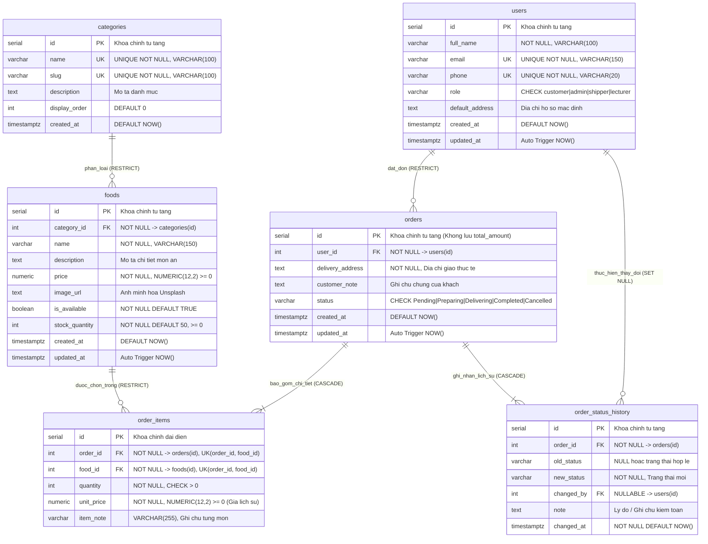
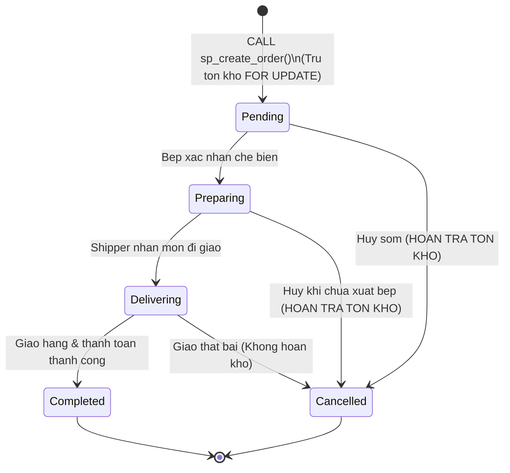
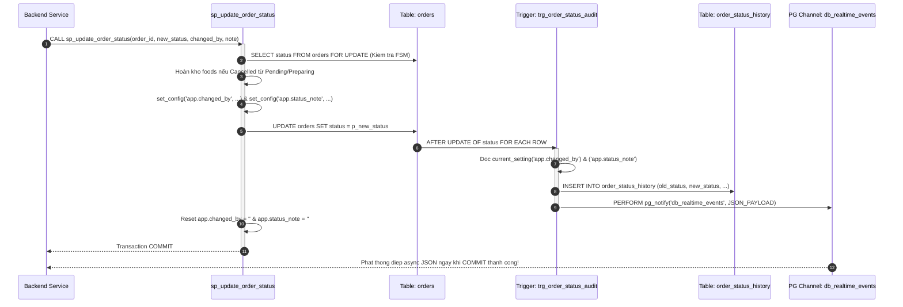

# Thiết Kế Cơ Sở Dữ Liệu Quan Hệ Chuẩn 3NF & Kiến Trúc Sự Kiện Thời Gian Thực (PostgreSQL 16)

> **Đề tài:** Hệ Thống Đặt Đồ Ăn Trực Tuyến Thời Gian Thực (*Real-time Online Food Ordering System*)  
> **Hệ quản trị CSDL:** PostgreSQL 16 (PL/pgSQL, Row-Level Locking, Transactional `LISTEN/NOTIFY`)  
> **Tập tin triển khai:**
> - DDL & View tổng hợp: [`01_schema_ddl.sql`](../database/01_schema_ddl.sql)
> - Triggers & Stored Procedures: [`02_triggers_and_procs.sql`](../database/02_triggers_and_procs.sql)
> - Dữ liệu thực nghiệm (Seed Data): [`03_seed_data.sql`](../database/03_seed_data.sql)

---

## 1. Tổng Quan Kiến Trúc Cơ Sở Dữ Liệu

Hệ thống được thiết kế theo triết lý **Database-Centric Integrity** (Bảo toàn toàn vẹn dữ liệu ngay tại tầng lõi CSDL), đảm bảo dữ liệu luôn nhất quán tuyệt đối bất kể thao tác đến từ Web App, REST API hay câu lệnh SQL trực tiếp trên công cụ quản trị:

1. **Chuẩn hóa 3NF nghiêm ngặt (Strict 3NF):** Triệt tiêu hoàn toàn dị thường thêm (*Insertion Anomaly*), dị thường sửa (*Update Anomaly*) và dị thường xóa (*Deletion Anomaly*). Không lưu trữ cột dư thừa `total_amount` trong bảng `orders`.
2. **Toàn vẹn tham chiếu có chủ đích (Intentional Referential Integrity):** Phối hợp chính xác 3 chiến lược khóa ngoại `ON DELETE RESTRICT` (bảo vệ dữ liệu lịch sử kế toán — mã lỗi PostgreSQL `23503`), `ON DELETE CASCADE` (dọn dẹp thực thể yếu phụ thuộc đơn hàng) và `ON DELETE SET NULL` (bảo toàn vết kiểm toán khi xóa nhân sự).
3. **Kiểm soát đồng thời bi quan (Pessimistic Concurrency Control):** Sử dụng `SELECT ... FOR UPDATE` kết hợp sắp xếp thứ tự khóa tăng dần theo `food_id` để ngăn chặn tuyệt đối cả hai bài toán kinh điển: **Bán âm kho (Overselling / Lost Update)** và **Khóa chết (Deadlock)**.
4. **Kiến trúc hướng sự kiện nội tại (Native Event-Driven DB):** Tận dụng PL/pgSQL Trigger kết hợp `pg_notify('db_realtime_events', ...)` phát sự kiện thời gian thực ngay khi Transaction `COMMIT`.

---

## 2. Sơ Đồ Thực Thể Kết Hợp (ERD — Chuẩn 3NF)



---

## 3. Từ Điển Dữ Liệu Chi Tiết (Data Dictionary)

### 3.1. Bảng `users` — Quản lý người dùng hệ thống

| Tên cột | Kiểu dữ liệu | Ràng buộc | Mô tả nghiệp vụ & Thiết kế |
| :--- | :--- | :--- | :--- |
| `id` | `SERIAL` | `PRIMARY KEY` | Định danh duy nhất của người dùng. |
| `full_name` | `VARCHAR(100)` | `NOT NULL` | Họ và tên đầy đủ của người dùng. |
| `email` | `VARCHAR(150)` | `UNIQUE, NOT NULL` | Địa chỉ email đăng nhập / liên hệ duy nhất. |
| `phone` | `VARCHAR(20)` | `UNIQUE, NOT NULL` | Số điện thoại liên hệ giao nhận hàng duy nhất. |
| `role` | `VARCHAR(20)` | `NOT NULL, DEFAULT 'customer', CHECK` | Phân quyền: `'customer'`, `'admin'`, `'shipper'`, `'lecturer'`. |
| `default_address` | `TEXT` | `NULLABLE` | Địa chỉ mặc định lưu trong hồ sơ cá nhân để điền nhanh khi đặt món. |
| `created_at` | `TIMESTAMPTZ` | `NOT NULL, DEFAULT NOW()` | Thời điểm tạo tài khoản (có múi giờ chuẩn ISO-8601). |
| `updated_at` | `TIMESTAMPTZ` | `NOT NULL, DEFAULT NOW()` | Thời điểm cập nhật hồ sơ gần nhất (tự động qua Trigger). |

### 3.2. Bảng `categories` — Danh mục ẩm thực

| Tên cột | Kiểu dữ liệu | Ràng buộc | Mô tả nghiệp vụ & Thiết kế |
| :--- | :--- | :--- | :--- |
| `id` | `SERIAL` | `PRIMARY KEY` | Mã danh mục tự tăng. |
| `name` | `VARCHAR(100)` | `UNIQUE, NOT NULL` | Tên danh mục hiển thị (VD: *Phở & Bún Truyền Thống*). |
| `slug` | `VARCHAR(100)` | `UNIQUE, NOT NULL` | Chuỗi định danh thân thiện URL (VD: `pho-bun-truyen-thong`). |
| `description` | `TEXT` | `NULLABLE` | Mô tả chi tiết nhóm ẩm thực. |
| `display_order` | `INT` | `NOT NULL, DEFAULT 0` | Thứ tự ưu tiên hiển thị trên thanh thực đơn. |
| `created_at` | `TIMESTAMPTZ` | `NOT NULL, DEFAULT NOW()` | Thời điểm khởi tạo danh mục. |

### 3.3. Bảng `foods` — Thực đơn món ăn & Tồn kho

| Tên cột | Kiểu dữ liệu | Ràng buộc | Mô tả nghiệp vụ & Thiết kế |
| :--- | :--- | :--- | :--- |
| `id` | `SERIAL` | `PRIMARY KEY` | Mã định danh món ăn. |
| `category_id` | `INT` | `NOT NULL, FK -> categories(id) ON DELETE RESTRICT` | Danh mục chứa món ăn; chặn xóa danh mục nếu còn món trực thuộc. |
| `name` | `VARCHAR(150)` | `NOT NULL` | Tên món ăn trên thực đơn. |
| `description` | `TEXT` | `NULLABLE` | Thành phần, hương vị và ghi chú giới thiệu món ăn. |
| `price` | `NUMERIC(12,2)` | `NOT NULL, CHECK (price >= 0)` | Đơn giá niêm yết **hiện hành** trên thực đơn (VNĐ). |
| `image_url` | `TEXT` | `NULLABLE` | Đường dẫn ảnh món ăn chất lượng cao. |
| `is_available` | `BOOLEAN` | `NOT NULL, DEFAULT TRUE` | Cờ cho phép mở bán / tạm ngưng phục vụ. |
| `stock_quantity` | `INT` | `NOT NULL, DEFAULT 50, CHECK (stock_quantity >= 0)` | Số suất tồn kho hiện tại; bảo vệ không bao giờ âm ở tầng CSDL. |
| `created_at` | `TIMESTAMPTZ` | `NOT NULL, DEFAULT NOW()` | Thời điểm thêm món ăn vào thực đơn. |
| `updated_at` | `TIMESTAMPTZ` | `NOT NULL, DEFAULT NOW()` | Thời điểm cập nhật thông tin hoặc biến động tồn kho gần nhất. |

### 3.4. Bảng `orders` — Đầu mục đơn đặt hàng (Order Header)

| Tên cột | Kiểu dữ liệu | Ràng buộc | Mô tả nghiệp vụ & Thiết kế |
| :--- | :--- | :--- | :--- |
| `id` | `SERIAL` | `PRIMARY KEY` | Mã vận đơn / hóa đơn. |
| `user_id` | `INT` | `NOT NULL, FK -> users(id) ON DELETE RESTRICT` | Khách hàng đặt đơn; không cho phép xóa cứng tài khoản đã có đơn. |
| `delivery_address` | `TEXT` | `NOT NULL` | Địa chỉ nhận hàng thực tế của riêng đơn hàng này. |
| `customer_note` | `TEXT` | `NULLABLE` | Lời nhắn giao hàng của khách (VD: *Giao trước 12h trưa*). |
| `status` | `VARCHAR(20)` | `NOT NULL, DEFAULT 'Pending', CHECK` | Trạng thái FSM: `'Pending'`, `'Preparing'`, `'Delivering'`, `'Completed'`, `'Cancelled'`. |
| `created_at` | `TIMESTAMPTZ` | `NOT NULL, DEFAULT NOW()` | Thời điểm khách đặt đơn. |
| `updated_at` | `TIMESTAMPTZ` | `NOT NULL, DEFAULT NOW()` | Thời điểm chuyển trạng thái / cập nhật gần nhất. |

> **Lưu ý thiết kế 3NF:** Bảng `orders` **tuyệt đối không lưu cột `total_amount`** nhằm tránh dư thừa dữ liệu dẫn xuất. Tổng tiền được tính động chính xác qua View `vw_orders_summary`.

### 3.5. Bảng `order_items` — Chi tiết dòng món ăn trong đơn (Order Lines)

| Tên cột | Kiểu dữ liệu | Ràng buộc | Mô tả nghiệp vụ & Thiết kế |
| :--- | :--- | :--- | :--- |
| `id` | `SERIAL` | `PRIMARY KEY` | Khóa chính đại diện dòng chi tiết đơn hàng. |
| `order_id` | `INT` | `NOT NULL, FK -> orders(id) ON DELETE CASCADE` | Đơn hàng sở hữu dòng chi tiết; xóa đơn tự động xóa chi tiết. |
| `food_id` | `INT` | `NOT NULL, FK -> foods(id) ON DELETE RESTRICT` | Món ăn được đặt; **chặn xóa cứng món ăn đã phát sinh đơn (`23503`)**. |
| `quantity` | `INT` | `NOT NULL, CHECK (quantity > 0)` | Số lượng phần ăn khách đặt. |
| `unit_price` | `NUMERIC(12,2)` | `NOT NULL, CHECK (unit_price >= 0)` | **Đơn giá chốt giao dịch lịch sử** tại thời điểm tạo đơn. |
| `item_note` | `VARCHAR(255)` | `NULLABLE` | Yêu cầu chế biến riêng từng món (VD: *Ít đá, không hành*). |
| *(Tổ hợp)* | `(order_id, food_id)` | `UNIQUE` | Đảm bảo mỗi món chỉ xuất hiện tối đa 1 dòng trên cùng một đơn hàng. |

### 3.6. Bảng `order_status_history` — Nhật ký kiểm toán trạng thái (Audit Log)

| Tên cột | Kiểu dữ liệu | Ràng buộc | Mô tả nghiệp vụ & Thiết kế |
| :--- | :--- | :--- | :--- |
| `id` | `SERIAL` | `PRIMARY KEY` | Mã bản ghi nhật ký kiểm toán. |
| `order_id` | `INT` | `NOT NULL, FK -> orders(id) ON DELETE CASCADE` | Đơn hàng được theo dõi vòng đời. |
| `old_status` | `VARCHAR(20)` | `NULLABLE, CHECK` | Trạng thái trước khi chuyển (`NULL` khi mới tạo đơn `NULL -> Pending`). |
| `new_status` | `VARCHAR(20)` | `NOT NULL, CHECK` | Trạng thái mới sau khi chuyển đổi. |
| `changed_by` | `INT` | `NULLABLE, FK -> users(id) ON DELETE SET NULL` | Người thực hiện thao tác; giữ nguyên lịch sử kể cả khi xóa user. |
| `note` | `TEXT` | `NULLABLE` | Ghi chú nghiệp vụ hoặc lý do hủy / chuyển trạng thái. |
| `changed_at` | `TIMESTAMPTZ` | `NOT NULL, DEFAULT NOW()` | Mốc thời gian chính xác diễn ra sự kiện chuyển trạng thái. |

### 3.7. Tổng hợp Ma trận Toàn vẹn Tham chiếu (Foreign Key Policies)

| Khóa ngoại | Bảng con -> Bảng cha | `ON UPDATE` | `ON DELETE` | Lý giải học thuật & Kịch bản thực nghiệm |
| :--- | :--- | :---: | :---: | :--- |
| `fk_foods_category` | `foods.category_id -> categories.id` | `CASCADE` | `RESTRICT` | Không thể xóa danh mục khi vẫn còn món ăn thuộc danh mục đó. |
| `fk_orders_user` | `orders.user_id -> users.id` | `CASCADE` | `RESTRICT` | Bảo vệ chứng từ giao dịch của khách hàng đã từng mua hàng. |
| `fk_order_items_order` | `order_items.order_id -> orders.id` | `CASCADE` | `CASCADE` | `order_items` là thực thể phụ thuộc hoàn toàn vào `orders`. |
| `fk_order_items_food` | `order_items.food_id -> foods.id` | `CASCADE` | **`RESTRICT`** | **Kịch bản Demo trọng tâm:** Món ID `9, 10` chưa có đơn hàng xóa cứng thành công; món ID `1..8` đã có đơn bị chặn với mã lỗi PostgreSQL `23503` (*foreign_key_violation*), buộc dùng xóa mềm (`is_available = FALSE`). |
| `fk_order_status_history_order` | `order_status_history.order_id -> orders.id` | `CASCADE` | `CASCADE` | Xóa đơn hàng sẽ dọn sạch lịch sử trạng thái gắn liền với đơn đó. |
| `fk_order_status_history_changed_by` | `order_status_history.changed_by -> users.id` | `CASCADE` | `SET NULL` | Nếu tài khoản nhân viên cũ bị xóa, dòng nhật ký kiểm toán vẫn được giữ lại với `changed_by = NULL`. |

---

## 4. Chứng Minh Chuẩn Hóa Dữ Liệu: UNF $\rightarrow$ 1NF $\rightarrow$ 2NF $\rightarrow$ 3NF

### 4.1. Xuất phát điểm: Quan hệ Chưa Chuẩn Hóa (UNF — Unnormalized Form)

Giả sử ban đầu cửa hàng quản lý đơn đặt món trên một bảng tính phẳng duy nhất `DON_HANG_UNF`:

| `order_id` | `created_at` | `user_id` | `full_name` | `phone` | `delivery_address` | `danh_sach_mon` *(Nhóm lặp đa trị)* | `total_amount` |
| :---: | :--- | :---: | :--- | :--- | :--- | :--- | :---: |
| 1 | 2026-11-07 | 4 | Phạm Minh Tuấn | 0901000004 | KTX Khu A | `[1 - Phở Bò - Phở & Bún - SL:2 - Giá:65k], [5 - Bánh Mì - SL:1 - Giá:35k]` | 165,000 |

**Các vấn đề nghiêm trọng ở UNF:**
- Chứa thuộc tính đa trị / nhóm lặp `danh_sach_mon` $\rightarrow$ Không thể đánh chỉ mục hay thống kê món bán chạy bằng SQL thuần.
- Dư thừa thông tin khách hàng, tên món, tên danh mục lặp đi lặp lại qua hàng nghìn đơn hàng.

---

### 4.2. Bước 1: Chuẩn hóa lên Chuẩn 1NF (First Normal Form)

> **Định nghĩa 1NF:** Quan hệ $R$ đạt chuẩn 1NF khi và chỉ khi mọi miền giá trị của các thuộc tính trong $R$ đều là **nguyên tố (Atomic)** — không chứa thuộc tính đa trị, thuộc tính phức hợp hay nhóm lặp.

**Thực hiện:** Tách mỗi món ăn trong `danh_sach_mon` thành một dòng riêng biệt, xác định khóa chính tổ hợp là `(order_id, food_id)`:

$$R_{\text{1NF}}(\underline{\text{order\_id}}, \underline{\text{food\_id}}, \text{user\_id}, \text{full\_name}, \text{email}, \text{phone}, \text{delivery\_address}, \text{status}, \text{food\_name}, \text{category\_id}, \text{category\_name}, \text{catalog\_price}, \text{quantity}, \text{unit\_price}, \text{total\_amount})$$

**Hạn chế còn tồn tại ở 1NF:** Xuất hiện hàng loạt **phụ thuộc hàm bộ phận (Partial Dependencies)** vào một phần của khóa chính tổ hợp `(order_id, food_id)`:
- $\text{order\_id} \rightarrow \{\text{user\_id}, \text{full\_name}, \text{email}, \text{phone}, \text{delivery\_address}, \text{status}, \text{total\_amount}\}$ *(chỉ phụ thuộc vào `order_id`, không phụ thuộc `food_id`)*.
- $\text{food\_id} \rightarrow \{\text{food\_name}, \text{category\_id}, \text{category\_name}, \text{catalog\_price}\}$ *(chỉ phụ thuộc vào `food_id`, không phụ thuộc `order_id`)*.

---

### 4.3. Bước 2: Chuẩn hóa lên Chuẩn 2NF (Second Normal Form)

> **Định nghĩa 2NF:** Quan hệ $R$ đạt chuẩn 2NF khi và chỉ khi $R$ đạt 1NF và mọi thuộc tính không khóa đều **phụ thuộc hàm đầy đủ (Fully Functionally Dependent)** vào mọi khóa dự tuyển của $R$ (không tồn tại phụ thuộc hàm bộ phận).

**Thực hiện:** Áp dụng định lý phân rã bảo toàn thông tin (Heath's Theorem), tách $R_{\text{1NF}}$ thành 3 quan hệ dựa trên các vế trái của phụ thuộc bộ phận:

1. **Quan hệ Đơn hàng (`ORDERS_2NF`):**
   $$\text{order\_id} \rightarrow \{\text{user\_id}, \text{full\_name}, \text{email}, \text{phone}, \text{default\_address}, \text{delivery\_address}, \text{status}, \text{total\_amount}\}$$
2. **Quan hệ Món ăn (`FOODS_2NF`):**
   $$\text{food\_id} \rightarrow \{\text{food\_name}, \text{price}, \text{stock\_quantity}, \text{category\_id}, \text{category\_name}, \text{category\_slug}\}$$
3. **Quan hệ Chi tiết đơn (`ORDER_ITEMS`):**
   $$(\text{order\_id}, \text{food\_id}) \rightarrow \{\text{quantity}, \text{unit\_price}, \text{item\_note}\}$$
   *(Bổ sung khóa đại diện `id SERIAL PK` kết hợp ràng buộc `UNIQUE(order_id, food_id)`).*

**Hạn chế còn tồn tại ở 2NF:** Vẫn còn **phụ thuộc hàm bắc cầu (Transitive Dependencies)** giữa các thuộc tính không khóa:
- Trong `ORDERS_2NF`: $\text{order\_id} \rightarrow \text{user\_id}$ và $\text{user\_id} \rightarrow \{\text{full\_name}, \text{email}, \text{phone}, \text{role}, \text{default\_address}\}$.
- Trong `FOODS_2NF`: $\text{food\_id} \rightarrow \text{category\_id}$ và $\text{category\_id} \rightarrow \{\text{category\_name}, \text{category\_slug}, \text{category\_description}\}$.
- Cột `total_amount` phụ thuộc dẫn xuất vào tập dòng `ORDER_ITEMS` ($\sum \text{quantity} \times \text{unit\_price}$).

---

### 4.4. Bước 3: Chuẩn hóa lên Chuẩn 3NF (Third Normal Form)

> **Định nghĩa 3NF:** Quan hệ $R$ đạt chuẩn 3NF khi và chỉ khi $R$ đạt 2NF và với mọi phụ thuộc hàm không tầm thường $X \rightarrow A$ trên $R$, hoặc $X$ là một **Siêu khóa (Superkey)** của $R$, hoặc $A$ là **Thuộc tính khóa (Prime Attribute)**. Nói cách khác: **Không có thuộc tính không khóa nào phụ thuộc bắc cầu vào khóa chính**.

**Thực hiện:**
1. Tách phụ thuộc bắc cầu `user_id -> ...` khỏi `ORDERS_2NF` thành bảng **`users`** và **`orders`**.
2. Tách phụ thuộc bắc cầu `category_id -> ...` khỏi `FOODS_2NF` thành bảng **`categories`** và **`foods`**.
3. **Loại bỏ hoàn toàn cột `total_amount` khỏi bảng `orders`**, thay thế bằng View tổng hợp động **`vw_orders_summary`**:
   ```sql
   COALESCE(SUM(oi.quantity * oi.unit_price), 0.00)::NUMERIC(12,2) AS total_amount
   ```
4. Tách lịch sử biến động trạng thái đa trị theo thời gian của đơn hàng thành bảng **`order_status_history`**.

### 4.5. Tổng hợp Kiểm chứng Phụ thuộc hàm trên 6 Bảng Thiết kế

| Bảng | Khóa dự tuyển (Candidate Keys) | Tập phụ thuộc hàm tối tiểu ($F_{\min}$) | Đánh giá Chuẩn |
| :--- | :--- | :--- | :---: |
| `users` | $\{id\}, \{email\}, \{phone\}$ | $id \rightarrow \text{tất cả thuộc tính còn lại}$ | **3NF & BCNF** |
| `categories` | $\{id\}, \{name\}, \{slug\}$ | $id \rightarrow \text{tất cả thuộc tính còn lại}$ | **3NF & BCNF** |
| `foods` | $\{id\}$ | $id \rightarrow \{category\_id, name, description, price, image\_url, is\_available, stock\_quantity, \dots\}$ | **3NF & BCNF** |
| `orders` | $\{id\}$ | $id \rightarrow \{user\_id, delivery\_address, customer\_note, status, created\_at, updated\_at\}$ | **3NF & BCNF** |
| `order_items` | $\{id\}, \{(order\_id, food\_id)\}$ | $(order\_id, food\_id) \rightarrow \{id, quantity, unit\_price, item\_note\}$ | **3NF & BCNF** |
| `order_status_history` | $\{id\}$ | $id \rightarrow \{order\_id, old\_status, new\_status, changed\_by, note, changed\_at\}$ | **3NF & BCNF** |

### 4.6. Giải trình Học thuật cho 2 Câu hỏi Phản biện Kinh điển của Hội đồng

1. **Câu hỏi 1: *"Bảng `foods` đã có cột `price`, tại sao bảng `order_items` vẫn lưu `unit_price`? Như vậy có vi phạm chuẩn 3NF không?"***
   - **Trả lời:** **Hoàn toàn KHÔNG vi phạm 3NF.** Trong nghiệp vụ thương mại điện tử, `foods.price` là **giá niêm yết hiện tại** ($P_{\text{current}}$), còn `order_items.unit_price` là **đơn giá chốt giao dịch lịch sử tại thời điểm đặt hàng** ($P_{\text{historical}}$).
   - Xét trên miền thời gian, `food_id` **không** xác định hàm duy nhất cho `unit_price` ($\text{food\_id} \nrightarrow \text{unit\_price}$), vì hôm nay *Phở Bò* giá `65,000đ` nhưng tuần sau tăng lên `70,000đ`. Đơn giá giao dịch phụ thuộc hàm đầy đủ vào cặp khóa **`(order_id, food_id) -> unit_price`**. Nếu không lưu `unit_price`, việc Admin điều chỉnh giá thực đơn sẽ làm sai lệch toàn bộ doanh thu kế toán của các hóa đơn trong quá khứ!

2. **Câu hỏi 2: *"Bảng `users` đã có `default_address`, tại sao bảng `orders` vẫn lưu `delivery_address`?"***
   - **Trả lời:** **Hoàn toàn KHÔNG vi phạm 3NF.** `users.default_address` là địa chỉ gợi ý mặc định trên hồ sơ hiện tại của khách ($\text{user\_id} \rightarrow \text{default\_address}$), trong khi mỗi đơn hàng cụ thể khách có thể chọn giao đến trường đại học, văn phòng, hoặc đặt đồ ăn tặng người thân ($\text{order\_id} \rightarrow \text{delivery\_address}$). Đồng thời, khi khách cập nhật địa chỉ nhà mới trong hồ sơ `users`, địa chỉ giao hàng trên các hóa đơn lịch sử đã hoàn tất phải được giữ nguyên bất biến.

---

## 5. Cơ Chế Triggers, Real-Time `pg_notify` & Stored Procedures

### 5.1. Sơ đồ Máy trạng thái Hữu hạn (FSM) của Đơn hàng

Được cưỡng chế trực tiếp bởi Stored Procedure `sp_update_order_status`:



### 5.2. Luồng Sự kiện Thời gian thực (`LISTEN / NOTIFY`) & Kiểm toán Tự động



### 5.3. Phân tích Kỹ thuật hệ thống Triggers

1. **`fn_set_updated_at()` (`trg_users_set_updated_at`, `trg_foods_set_updated_at`, `trg_orders_set_updated_at`)**
   - Kích hoạt `BEFORE UPDATE FOR EACH ROW` gán trực tiếp `NEW.updated_at := NOW()` trước khi ghi đĩa, không tốn thêm truy vấn `UPDATE` phụ.

2. **`trg_order_status_audit` (`AFTER INSERT OR UPDATE OF status ON orders`)**
   - Kết hợp kỹ thuật **Session Context Passing**: Stored Procedure truyền `changed_by` và `note` qua `set_config('app.changed_by', ..., true)` (`is_local = true` chỉ có hiệu lực nội bộ trong Transaction hiện hành).
   - Ngay cả khi quản trị viên chạy câu lệnh `UPDATE orders SET status = 'Preparing' WHERE id = 3;` trực tiếp trên DBeaver/psql không qua ứng dụng, Trigger **vẫn tự động bắt được biến động**, ghi vết vào `order_status_history` và bắn `pg_notify` lên giao diện Web tức thì!
   - Cấu trúc Payload JSON trên kênh `db_realtime_events`:
     ```json
     {
       "source": "pg_trigger",
       "event": "order_status_changed",
       "table": "orders",
       "action": "UPDATE",
       "record_id": 2,
       "data": {
         "order_id": 2,
         "old_status": "Preparing",
         "new_status": "Delivering",
         "changed_by": 3,
         "note": "Shipper đang trên đường giao đến cổng Lý Thường Kiệt"
       },
       "timestamp": "2026-11-07T09:30:00.000000+07:00"
     }
     ```

3. **`trg_foods_realtime_notify` (`AFTER INSERT OR UPDATE OR DELETE ON foods`)**
   - Phát sự kiện `food_created`, `food_updated`, `food_deleted` qua cùng kênh `db_realtime_events` mỗi khi thực đơn thay đổi hoặc `stock_quantity` tăng/giảm (khi có khách đặt đơn hoặc hủy đơn), giúp mọi màn hình khách hàng đang mở đều thấy số lượng tồn kho nhảy số theo thời gian thực.
   - **Ưu điểm Transactional `pg_notify` của PostgreSQL 16:** Nếu trong một giao dịch đặt 3 món mà món thứ 3 hết hàng gây `ROLLBACK`, mọi lệnh `pg_notify` của món 1 và món 2 đều bị hủy bỏ tự động bởi PostgreSQL — không bao giờ phát sự kiện "ma" (*Phantom Notification*) ra ngoài!

### 5.4. Phân tích Kỹ thuật 3 Stored Procedures

| Stored Procedure | Chữ ký (Signature) | Đảm bảo Nghiệp vụ & Toàn vẹn Giao dịch (ACID) |
| :--- | :--- | :--- |
| **`sp_create_order`** | `(p_user_id INT, p_delivery_address TEXT, p_customer_note TEXT, p_items JSONB, INOUT p_order_id INT DEFAULT NULL)` | 1. Gộp các mục trùng `food_id` trong JSON đầu vào.<br>2. **Chống Deadlock & Overselling:** Sắp xếp danh sách món theo `ORDER BY food_id ASC` trước khi khóa dòng `SELECT ... FROM foods WHERE id = ... FOR UPDATE`. Hai giao dịch đặt `[Món 5, Món 1]` và `[Món 1, Món 5]` cùng lúc sẽ luôn xin khóa `Món 1` trước rồi mới tới `Món 5`, triệt tiêu hoàn toàn vòng chờ Deadlock.<br>3. Trừ `stock_quantity` và chốt giá lịch sử `unit_price := foods.price`. |
| **`sp_update_order_status`** | `(p_order_id INT, p_new_status VARCHAR, p_changed_by INT DEFAULT NULL, p_note TEXT DEFAULT NULL, p_force BOOLEAN DEFAULT FALSE)` | 1. Khóa dòng `orders` bằng `FOR UPDATE`.<br>2. Kiểm tra nghiêm ngặt luồng FSM (`Pending -> Preparing -> Delivering -> Completed` hoặc `-> Cancelled`), hỗ trợ `p_force = TRUE` cho quyền cứu hộ của Admin.<br>3. **Hoàn kho thông minh:** Tự động cộng trả lại `foods.stock_quantity` theo thứ tự `food_id ASC` khi đơn bị hủy ở giai đoạn `Pending` hoặc `Preparing`. |
| **`sp_upsert_food`** | `(INOUT p_food_id INT, p_category_id INT, p_name VARCHAR, p_description TEXT, p_price NUMERIC, p_image_url TEXT, p_is_available BOOLEAN, p_stock_quantity INT)` | Kiểm tra tính hợp lệ của danh mục, giá (`>= 0`), tồn kho (`>= 0`); tự động phân nhánh thêm mới (`p_food_id IS NULL`) hoặc cập nhật món ăn hiện có và đồng bộ Sequence an toàn. |
